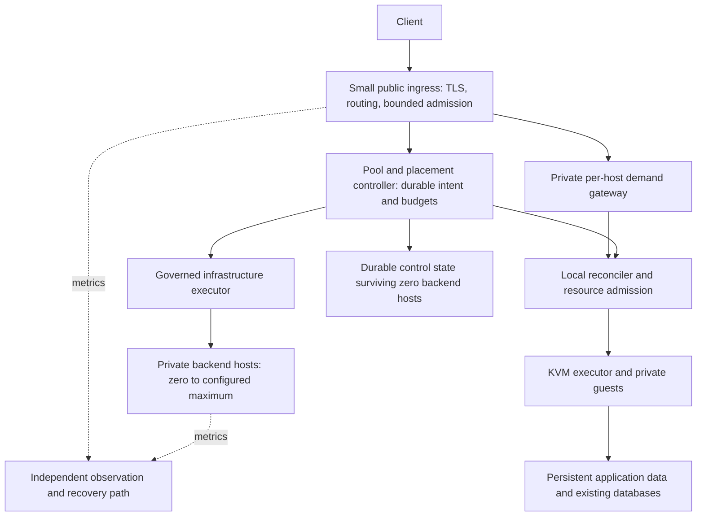
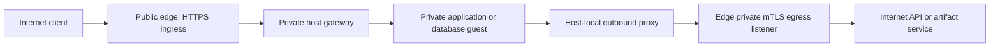

# RFC-0001: Sufuree — scale-to-zero unikernel runtime

**Status:** Accepted design on merge of PR #1 through the owner-authorized independent review and merge workflow; bounded version-one scope. This is the canonical shared-runtime and application RFC; [RFC-0002](0002-scale-to-zero-databases.md) extends it for databases. Acceptance applies to the architecture and defaults below; it does not claim implementation, runtime qualification or authorize infrastructure changes.

**Design discussion:** October 31–November 1, 2026. **Primary language:** Go. **Initial provider:** AWS qualification candidate; cloud and VM/bare-metal differences remain explicit capability boundaries.

Sufuree routes requests to isolated application guests, starts them on demand, schedules them onto suitable hosts, and grows or shrinks the backend host pool down to zero. Its purpose is to reduce the cost of idle personal projects while preserving useful performance, isolation and recoverability. Prefer small unikernel guests; retain Linux guests for applications that require them.

At zero backend demand, the intended minimum is a small reachable ingress/controller and its durable state. The backend compute pool can be empty; retained storage, backups and existing databases continue to cost money. The initial workload and capacity measurements are inputs to this design, not proof that it already works.

This document consolidates the original proposal, architecture review, topology and observability requirements, the source orchestrator reuse assessment and full system review. The [original proposal is archived](../archive/rfc-0001-original-proposal.md) for provenance; it is not a second specification. Cost and usage receipts remain [supporting research](#12-evidence-and-supporting-research).

Contents: [requirements](#1-requirements-and-scope), [ownership](#2-ownership-and-integration-boundaries), [architecture](#3-architecture-and-lifecycle-ownership), [request lifecycle](#4-workload-contract-and-request-lifecycle), [scheduling](#5-host-scheduling-and-autoscaling), [networking](#6-networking-and-security), [durability](#7-persistent-state-artifacts-and-recovery), [lifecycle reuse](#8-lifecycle-reuse), [observability](#9-observability-and-sizing), [review gates](#10-review-findings-and-qualification-gates), [qualification](#11-qualification-and-acceptance), [evidence](#12-evidence-and-supporting-research), [owner acceptance](#13-owner-acceptance-record).

## 1. Requirements and scope

- Optimize for cost and performance on personal workloads; there are no clients currently.
- Prefer small, fast-starting unikernel guests; allow Linux guests where applications require them.
- Begin with one tiny ingress VM running Sufuree as a unikernel, with one public IPv4 address and `t8i.nano` as the candidate. Backend guests use private addresses on a separate host; that host may be a qualified VM or bare-metal instance.
- Keep VM/bare-metal and cloud-specific execution behind capability interfaces. This is portability intent, not evidence of multiple working providers.
- Reuse the source orchestrator's scheduling/lifecycle mechanisms where suitable rather than build a second independent engine.
- Observability must show when capacity needs changing.
- **The backend host pool must automatically grow, shrink and reach zero when no workload requires it.** A single-host experiment is a qualification step, not the completed product.
- Database scale-to-zero is a separately qualified capability in the same Sufuree repository, defined in [RFC-0002](0002-scale-to-zero-databases.md). Existing stateful applications still require safe storage and recovery in Sufuree.

The concrete version-one defaults below are accepted together through the owner-authorized review-and-merge workflow identified in Section 13. Runtime/library versions must be pinned in qualification receipts before tests; current candidates are not qualification evidence. This RFC does not authorize provisioning, migration, shutdown, spending, changes to the source orchestrator or cloud credential changes.

### Initial scope and deferred features

The first end-to-end slice is a stateless Go HTTP qualification workload on one pinned guest/VMM combination; it need not migrate an existing application. Qualify stateful workloads separately. The completed initial product must demonstrate automatic zero-to-one-to-zero host capacity and bounded two-host placement/draining; guest sleep alone is insufficient.

Defer BaaS/golden appliances, schema reflection, GraphQL, polyglot function sandboxes, router-held realtime subscriptions, mandatory SIMD parsing, live migration and memory-snapshot optimization. The first application slice uses one replica; the multi-replica routing contract below must be qualified before horizontal service scaling is enabled. Automatic replica-count tuning follows the proposed policy in Section 5, with numerical settings and runtime qualification outstanding; it is distinct from required host-pool autoscaling. Database-specific qualification is defined in RFC-0002. Supporting a Node application as a qualified guest is different from building a hosted JavaScript/Python execution platform.

### Repository, commands and runtime roles

Owner decision: one Sufuree repository with application and database commands and shared packages inside it; no separate database or `pkg` repository is required. `sufuree app` and `sufuree db` are proposed command names, not a promise of two deployed services. Common lifecycle, journal, scheduling, gateway, executor and telemetry code is shared; database handlers add storage and engine-specific contracts.

Runtime roles are the gateway, durable controller/capacity planner, host agents and workload guests. The gateway routes and balances requests; the controller owns placement and host capacity; agents execute assignments. Roles can share qualified processes or machines without implying one paid server per role. Co-location shares a failure domain and does not relax resource or credential boundaries. One authoritative capacity ledger covers all application/database pools; CLI commands do not start competing schedulers. RFC-0002 describes the database extension to these same roles.

Keep provider-neutral contracts, but implement additional clouds only as they are qualified. Start with one durable control owner and an explicit availability limitation. The proposed replication path is Raft for authoritative controller state, with proxy scale-out independent of voting membership; see the control-replication contract below. A multi-node quorum is not required for the initial cost floor. A two-voter cluster cannot tolerate loss of either voter.

The original 5–20 ms wake figures, two-second compilation estimate, 15 ms replacement and 25-day implementation schedule are unqualified proposals, not promises in this RFC. Separate warm-host guest startup from cold-host provisioning and measure both.

## 2. Ownership and integration boundaries

Sufuree owns runtime desired state, workload placement and its capacity journal. Infrastructure custodians own cloud-effect credentials and authorized IaC programs; product clients own customer/domain identity; observability systems receive evidence without gaining mutation authority. Each integration is optional and versioned: Sufuree remains independently usable.

An infrastructure inventory is an observation source, not provisioning authority. Existing enrollment, budgets and recovery ownership cannot be bypassed through a new Sufuree command. Retired or unknown resources are excluded from migration until their owner explicitly determines disposition. Private inventory and source-review receipts remain outside this public specification.

One lifecycle/effect has one authoritative scheduler and journal. Parent products keep references and projections rather than duplicate executable children. Integrations use scoped principals and supported interfaces, and do not transfer another product's records, credentials or effect authority. No hardcoded customer/application taxonomy is required by the runtime.

## 3. Architecture and lifecycle ownership

The small ingress and pool controller must remain reachable when the backend pool is empty. They can initially be one process if their combined footprint fits the nano; that fit is unmeasured. Do not keep the only scheduler, journal, secrets needed for bootstrap or artifact catalog on a host that is allowed to disappear.

Owner direction: keep Go on a qualified unikernel as the intended always-on gateway/controller runtime. Linux is a fallback for a demonstrated incompatibility, not a prerequisite inferred from the need for persistence or networking. Pin and test the journal's synchronization/locking/storage behavior and the selected private-backend egress design. Go/volume support alone does not qualify crash durability, NAT or the combined memory footprint.

One lifecycle has one owner. The pool controller owns placement intent and host capacity requests. A host reconciler executes an assigned workload generation and owns local admission, readiness, demand leases and cleanup. It cannot independently relocate that workload or create cloud hosts. The owning infrastructure system retains cloud effect custody; its execution contract is a dependency, not a currently qualified autoscaler API.

A private per-host demand gateway is the recommended first reuse boundary: it lets the source orchestrator's request leases and idle decisions remain next to the executing guest. The public edge proxies to that gateway. Moving lease accounting entirely to the public edge would require a new distributed activity protocol. Either design still needs placement fencing and restart handling; local locks alone cannot fence separate hosts.

Before a host exists, waiting demand is a bounded activation claim against the controller's workload identity, not a lease in a nonexistent host's memory. The host gateway must accept the assigned generation and acquire its local activity lease before forwarding any bytes to the guest. Only after that acknowledgement may the edge release its pending activation claim. Use stable request/activation identities to reconcile handoff cancellation, duplicate delivery and lost acknowledgements without counting one request twice. Host-local leases, not sampled edge metrics, authorize local idle shutdown. Cancelling a caller cannot declare execution complete if the backend is still doing work; the host retains protection until completion is observed or the workload's explicit cancellation contract is satisfied. This protocol and its wire schema still require implementation and failure tests.

Guest lifecycle and host lifecycle are distinct. A guest moves through dormant, starting, ready, draining/stopping and dormant again; failures can leave its outcome unknown and requiring reconciliation. A host moves through provisioning, ready, draining and terminated, with uncertain provider outcomes tracked explicitly. Readiness is not implied by process existence. A stopped guest does not by itself stop its paid host.

Commit operation intent and placement identity before dispatching effects. The host rejects stale generations. A successful observation confirms the resulting state; a timeout retains the unresolved operation and its reservations. The bbolt/Raft storage stack and command envelope below specify the initial mechanism. Pin versions and encode the versioned wire schema before qualification; neither is an existing implementation.

### Declarative control and reconciliation

Use declarative resource specifications and reconciliation as the control model. Borrow the useful separation between [desired state and observed status](https://kubernetes.io/docs/concepts/overview/working-with-objects/), [controllers that reconcile differences](https://kubernetes.io/docs/concepts/architecture/controller/) and [deletion cleanup barriers](https://kubernetes.io/docs/concepts/overview/working-with-objects/finalizers/). This does not require Kubernetes, etcd, its API server or its full object model. The minimal protocol below is proposed; storage and provider implementations remain subject to F01/F17.

| Record | Writer and meaning |
| --- | --- |
| Resource `spec` | Authorized caller declares the workload image/engine, resources, routing, persistence, activation and scaling limits. A pool spec declares admissible host capabilities, minimum/maximum capacity and budget. |
| Resource identity and revision | Stable UID distinguishes delete/recreate; a spec generation changes only when desired configuration changes. Conditional updates reject stale caller revisions rather than silently losing another change. |
| Demand and computed target | The demand/replica controller derives current execution needs within the spec. It does not overwrite the caller's minimum/maximum policy. Pending demand is bounded and scoped to the current resource UID. |
| Placement and operation journal | The authoritative planner records assigned replica/host/volume identities, controller/placement epochs, reservations, operation IDs and unresolved outcomes before effects. Epochs and operation IDs are distinct from spec generations. |
| Observed `status` | Controllers/agents report the generation evaluated, actual capacity/readiness, timestamps and conditions such as dormant, starting, ready, draining, budget-limited or recovery-required. An observed generation does not alone mean the resource is ready. |

An enabled workload means "make this service available according to its policy," not "keep one process running forever." With minimum replicas zero and no protected demand, a dormant guest and an empty backend pool satisfy the desired state. A registered database retains its volume identity while dormant. `suspended` rejects new activation and drains existing work safely; it does not delete retained data. `deleting` records a separate authorized lifecycle intention and prevents new activation. A suspended/deleting resource cannot be resurrected by a stale queue item or a late autoscaler observation.

Illustrative policy, not a final configuration schema: an enabled service may allow zero to four replicas, wake on HTTP demand, retain its guests for an idle window and preserve declared data. Demand can change its computed execution target from zero to two and back without repeatedly editing the service specification. Its host pool expands only when admitted placements cannot fit; optional warm capacity is a separate pool policy.

The reconciliation loop is level-based: read the latest spec, fresh observations and unfinished operations; derive the next safe transition; persist its intent/reservations transactionally; then dispatch the scoped effect and reconcile its result. Events request a recheck of resource identity, not unconditional execution of the event's historical command. Bounded periodic reconciliation repairs missed notifications. Backoff and fairness prevent failing resources from monopolizing the controller or provider API.

1. Validate caller authority, schema and expected revision before committing a desired-state change. Reapplying identical configuration is idempotent and does not start another guest or buy another host.
2. Before dispatch, atomically validate the current resource generation/owner epoch and reserve the operation's capacity/budget. If the journal commit fails, dispatch nothing that depends on it. Never publish readiness solely because the spec was accepted.
3. Dispatch a stable operation identity to an executor that enforces idempotency/generation ownership where supported. A lost reply leaves the outcome unknown; query host/provider evidence by operation/resource identity before a retry. The journal does not grant exactly-once cloud effects.
4. Reconcile incomplete effects before applying a newer conflicting spec. Do not free reservations or declare a stop complete just because the next desired state changed. Incompatible changes wait for safe drain/cleanup and surface that condition.
5. On controller restart, load unfinished operations, discover/reconcile owned hosts/guests/attachments and re-establish actual ownership before dispatching conflicting work. Start with one active controller and durable control state outside the sleeping pool. Replacement must fence the old control owner; a new epoch written only in the replacement's local store is insufficient.

Deletion uses explicit cleanup conditions: traffic admission closed, active work safely drained, writer/attachment ownership reconciled, and retained-data disposition recorded. Keep the resource/tombstone until those obligations are satisfied. A timeout exposes blocked cleanup rather than removing the record and leaking or deleting resources blindly. Deleting a parent does not automatically authorize cascading database-volume deletion.

CLI and API actions enter the same desired-state/operation path. A direct command cannot bypass an existing owner, budget, retention policy or provider custody. Persist lifecycle intent and pending activation ownership as required for recovery, not every request payload or every high-frequency counter; request bodies and credentials do not belong in the control journal. Gateway loss may still fail in-flight requests. Reconciliation restores resource state, not vanished client connections or an unknowable database transaction outcome.

For the separate application-write boundary, use RFC-0002's [uncertain-commit and optional safe-retry contract](0002-scale-to-zero-databases.md#62-lost-replies-uncertain-commits-and-optional-safe-retries). Infrastructure operation IDs do not deduplicate arbitrary application mutations; the optional mutation/result record must commit atomically beside the affected data.

### Proxy scale-out and controller replication

Owner decision: use Raft for replicated authoritative control state, with [HashiCorp's Go Raft implementation](https://github.com/hashicorp/raft) selected conditional on compatibility with the chosen unikernel. Its persistent log/stable stores, snapshots, transport, resource footprint and failure behavior must be qualified; bbolt v2 and file snapshots are the proposed storage stack, with exact versions to pin before qualification. Raft is not the disk store and does not remove those implementation choices. If a concrete incompatibility is found, report it and revisit the affected component rather than silently replacing the intended unikernel tier.

| Role | Scaling and state contract |
| --- | --- |
| Proxy/gateway | Add forwarding instances independently of controller membership. Each consumes authenticated versioned route updates/snapshots and sends activation/control requests to the authoritative controller. Per-request routing, buffers and host-local activity leases do not require a Raft log entry. |
| Controller | One elected leader proposes desired-state changes, placement ownership, operation intent, reservations and membership changes to a replicated state machine. Other voters replicate and may forward commands; they do not run independent competing capacity planners. Replication primarily provides availability, not linear write-throughput scaling. |
| Host/executor | Validate assigned identities/generations and operation IDs and reconcile uncertain effects. Consensus on intent does not itself revoke an isolated old leader's provider credentials or stop a stale database writer. |

The cost-first deployment has one controller and durable storage. Evaluate a one-voter Raft configuration as the way to keep the same state-machine/journal API from the start; it has no failover or replicated-data protection. A qualified HA deployment uses three voters in independent failure domains, with two needed to commit, and can tolerate one voter loss. Two voters still need both and do not meet that failure target. See [quorum sizing](https://etcd.io/docs/v3.6/faq/). Three controller voters need not all expose public IPs or run proxies; a proxy does not become a voter merely because it was added for traffic capacity.

Never automatically scale a three-voter control cluster down with the backend workload pool. Membership changes are durable, serialized administrative operations with catch-up/health and quorum checks. Snapshot/restore must include committed control state, operation identities and ownership metadata; bootstrap or disaster recovery cannot silently create a second authoritative cluster. Define the one-to-three transition and recovery procedure before claiming it works.

If quorum is unavailable, reject/defer new control mutations and capacity/writer changes rather than guessing. Existing traffic can continue only over still-authorized endpoint generations and valid host-local admission; a cached route is not permission for stale placement or revoked access. Define route/auth freshness bounds and partition behavior before enabling multiple gateways. Existing streams may remain pinned, but proxy loss still breaks its connections; Raft does not migrate sockets or preserve application sessions.

Effects occur only after their intent is committed, through the scoped executor and operation fence. Leadership changes must reconcile unfinished effects before conflicting dispatch; a new Raft term alone is not a sufficient fence for external storage/cloud systems. The executor and hard-fencing contracts below resolve the version-one design; F01/F02/F17 remain implementation/qualification gates. Public DNS/address distribution and failover remain a separate F19 design; consensus does not solve how clients reach the gateways.

### Proposed durable control storage

Use `github.com/hashicorp/raft-boltdb/v2` backed by `go.etcd.io/bbolt` as the first qualification candidate for Raft's `LogStore` and `StableStore`. The [v2 adapter source](https://raw.githubusercontent.com/hashicorp/raft-boltdb/master/v2/bolt_store.go) implements both interfaces using bbolt. Keep synchronization enabled (`NoSync=false`) and reject unsafe storage configurations. This is a proposed dependency choice, not a passing unikernel compatibility result or a pinned release.

Pair it with Raft's [file snapshot store](https://pkg.go.dev/github.com/hashicorp/raft#FileSnapshotStore) on the explicitly identified persistent controller volume. The application state machine derives desired resources, operation records, reservations and ownership from committed commands; `StableStore` is Raft metadata, not an automatic application-state database. Restore application state from a consistent state-machine snapshot plus committed log replay. Query indexes may be rebuilt, but authority/operations may not be invented from a missing cache. Bound resident metadata and snapshot work within the initial instance budget; do not assume the large dormant-fleet target fits in 512 MiB.

Qualification must cover bbolt's [memory mapping, file locking and synchronized writes](https://github.com/etcd-io/bbolt), file growth, disk-full/read-only errors, interrupted first initialization, snapshot publication, compaction and crash recovery under the pinned unikernel/filesystem/block-device stack. Pure Go avoids a C integration requirement but does not eliminate operating-system dependencies. Never trade away flush/locking guarantees to make a benchmark pass. Each voter owns its own durable files; voters replicate through Raft, not by sharing one writable bbolt file.

Snapshots must bind the applied log position, state schema, cluster identity and all operation/reservation/ownership state before old log entries are discarded. A local snapshot is not an independent backup of a failed controller volume. Test separately retained encrypted backup/restore and retention policies. If this stack fails qualification, identify the failing primitive and compare a compatible store before reconsidering the intended unikernel runtime.

### Controller bootstrap, membership and failover

Version one has a single voting controller. The one-to-three and automatic multi-voter sections below are the later HA profile; enabling them requires a tested abort/recovery procedure for the transitional two-voter phase and an effect/recovery network path independent of the edge being fenced. Merely adding private voters behind that edge is insufficient.

Initial bootstrap order: (1) the owner runs checked-in IaC to establish the encrypted control volume, S3 IaC/backup buckets, DynamoDB worker gate, KMS keys, restricted roles and worker in bootstrap-disabled mode; (2) the new edge verifies/initializes its explicitly authorized journal and generates its control signing key locally; (3) the owner verifies the instance/key binding and registers its public key and initial incarnation/epoch in the worker gate; (4) the owner enables the first bounded grant; (5) the controller may begin resource reconciliation/effects. Runtime nodes never self-grant initial cloud authority.

Use KMS envelope encryption for CA/control secrets. The edge role has only deployment-key unwrap permission plus scoped worker invocation; the owner recovery principal has the independently retained unwrap/recovery grant. No plaintext CA key enters images or userdata. Backup upload uses a separate bounded on-demand signing handler with a restricted object-upload role, independent of the busy mutation worker, to issue short-lived presigned URLs restricted to unique encrypted objects and an integrity manifest; snapshot bodies do not travel inside Lambda invocation payloads. The signer checks the current deployment and backup identity in the gate, has no provider-resource or retention mutation permission, and cannot overwrite or expire existing backup objects. Recovery readers are separately authorized.

On backup restore, the worker atomically allocates a strictly newer recovery incarnation and advances owner/placement epochs above all surviving observed values. Include that incarnation plus globally unique IDs in operation/resource/placement identities, grants and provider idempotency tokens; never derive identity solely from a replayable log index. Quarantine surviving resources whose journal history is missing, and reconcile them before new placements. Retain old incarnation tombstones; do not reissue an old authority after rollback.

Proposed operational rules for the selected Raft implementation:

1. **Explicit creation:** First bootstrap requires a provisioned cluster identity, initial member identity, authenticated peer trust and an explicitly initialized journal volume. Persist the cluster/member/storage bindings. Only the designated bootstrap operation creates the initial one-voter configuration. An ordinary restart, missing mount or empty directory must never automatically create a fresh cluster or substitute empty state.
2. **Restart:** Verify volume and cluster identity, open the existing stable/log stores, restore the matching state-machine snapshot and replay committed entries. Wait for valid leadership and reconcile unfinished effects before dispatching new conflicting operations. A failed or incompatible store is a recovery-required condition, not permission to reset the journal.
3. **Expansion:** Authenticate new peers and admit them as non-voting replicas first. Verify durable catch-up and capacity before serial membership promotions under the current leader. Promote toward three voters one at a time using the committed configuration as the precondition; document the transitional two-voter phase, where both are required. Do not advertise one-failure tolerance until all three voters are healthy and caught up. Backend autoscaling never changes this membership.
4. **Normal leader loss:** With three healthy voters, the surviving majority elects a leader. The new leader establishes current committed state and reconciles pending operations before conflicting effects. The old leader cannot commit new control mutations without quorum. External executors must still reject stale ownership and reconcile operations already dispatched; election alone is not proof those effects stopped.
5. **No quorum or single-member loss:** Stop new control mutations/capacity/writer changes. Retain budgets, reservations and uncertainty. If the only member's durable volume survives, recover it only after proving the former control owner is fenced. Restore from backup requires checking for newer provider/host effects and retained identities; it must not reset spent budgets or assume old pending operations never ran.
6. **Disaster recovery:** Treat forced cluster recovery/reconfiguration as an explicit owner-controlled procedure with the old authority fenced and current host/volume inventory reconciled. Validate backup format, integrity, encryption keys and recovery identity before resuming effects. Never invoke recovery merely because an election timed out. Its concrete implementation and fault tests remain F01/F17 qualification gates.

These rules use the library's [bootstrap, non-voter admission and recovery APIs](https://pkg.go.dev/github.com/hashicorp/raft). Verify exact semantics against the pinned version before implementation; no API invocation alone establishes the required external ownership proof. Add failure tests for missing journal mount, repeated bootstrap, stale member disk, interrupted promotion, minority partition, lost effect acknowledgement and backup rollback. Measure the library plus storage/transport on the intended small unikernel instance rather than assuming a pure-Go dependency automatically fits.

### Scoped executor and enforceable ownership

Version one uses an executor capability authorized by infrastructure custody implemented from the owning IaC repository's templates and deployment grants. It is not an assumption that a ready-made infrastructure custody service already exists. Define a small API: describe owned resources, create a host from an approved template, terminate a host, attach/detach a registered volume, create a snapshot, request policy-eligible snapshot expiry, restore a registered snapshot into a new volume, and manage the deployment's declared address/network bindings. Inputs contain immutable resource IDs, operation ID, recovery incarnation, controller ownership epoch, grant revision, expected resource generation, template revision and secret references. No arbitrary shell, IAM policy editing, AMI selection or cross-deployment mutation is exposed through a workload request.

Snapshot expiry and restore are distinct authorized operations. Expiry requires the exact snapshot identity, retention-policy revision and verified catalog preconditions; it cannot remove the last validated recovery point, a legal/owner hold, an in-progress restore source or a protected pre-upgrade point. Restore creates a new retained volume with a new identity, manifest and placement binding; it never overwrites the source or silently replaces the active volume. Verify content before explicit cutover. Database/volume destruction requires a separate owner-authorized deletion operation and is outside routine idle cleanup and backup retention. The worker owns the authoritative backup catalog, retention revision and protected-point markers. Store them in dedicated DynamoDB catalog records with append-only recovery receipts in an independently protected, owner-custodied object prefix. On gate/catalog rollback, freeze expiry until catalog history and protected markers have been reconstructed and reconciled from those receipts; missing history cannot authorize deletion. Retention uses provider creation timestamps in hourly/daily time buckets, not the count or timing of edge requests. Rate-limit ordinary snapshot creation to one per volume per configured hourly bucket; a pre-upgrade point requires its unique authorized upgrade operation. Extra recovery snapshots need a separately bounded owner grant. Repeated requests cannot churn protected history out of retention. The edge cannot declare a point verified, lower retention or remove protection. Qualification restore jobs use a separate scoped verifier identity to sign evidence bound to an exact snapshot, challenge and restore result; the worker validates and records that receipt. Expiry is worker-computed from owner-approved policy and those receipts, never from an edge-supplied candidate list alone. The independently authorized recovery principal controls policy changes and deletion of protected points. Thus a compromised edge cannot turn repeated retention requests into deletion of all historical recovery copies. Reconcile uncertain expiry/restore outcomes by the same operation identity.

Backup verification uses a bounded, separately launched verifier guest from a worker-approved immutable template, on isolated scratch capacity authorized by the maintenance allowance. It restores a new volume, checks recorded content/integrity with the pinned engine, signs the exact challenge/snapshot/result using a verifier-only key or KMS signing grant, then releases scratch resources through the worker. The worker binds the receipt to that launch and image; the edge cannot substitute images, userdata, result bodies, or assume the verifier role. Host/application credentials cannot access this verifier identity. The verifier job may use Linux for orchestration and signing, but the restore must run the snapshot's manifested guest runtime, filesystem format and engine on qualified scratch capacity. A Linux reference guest may validate only Linux-format volumes or a qualified logical export. The receipt records the runtime used; validation on another path does not make a point restore-validated for the production path. This auxiliary job does not change the intended customer or edge unikernel runtime. Provision key policy, image allowlist, immutable job inputs and scratch limits through the owning IaC, and qualify against forged/replayed receipts and compromised-edge attempts.

The backup catalog distinguishes `created` (provider completion), `integrity-checked` (manifest/source identity and integrity metadata verified) and `restore-validated` (independent verifier receipt confirms recovered content). The first point for each engine/filesystem contract and pre-upgrade points must be restore-validated; periodic policy-selected points are also restored. Routine intermediate snapshots may remain integrity-checked under that already qualified recovery contract. Retention never deletes the last restore-validated point; unvalidated replacements cannot release that protection. Report freshness of both the newest integrity-checked point and newest actual restore validation, and degrade protection if their separate policy windows are missed. Never label provider completion alone as validation.

The initial AWS effect worker is an on-demand, non-VPC Lambda container running a pinned Pulumi Automation API program from the owning infrastructure repository. It uses public AWS service endpoints and does not need direct access to guest networks. It has no additional always-on VM or allocated public IPv4; invocation, execution, image and state-storage charges still count. This provider-specific component is intentionally outside the unikernel: Pulumi/provider executables run in its Linux environment, while the edge sends Go API requests. Provision the worker and its narrow IAM permissions through the owning IaC. The edge has scoped worker invocation and deployment-key unwrap authority, not EC2/volume mutation credentials; backup upload uses restricted worker-issued URLs. AWS's [Lambda execution limit](https://docs.aws.amazon.com/lambda/latest/dg/configuration-timeout.html) requires bounded steps and reconciliation after timeout; use a [container image](https://docs.aws.amazon.com/lambda/latest/dg/images-create.html) with the program/CLI/plugins already pinned and present.

Use an encrypted, durable IaC state backend available independently of the edge (initially an owned S3 backend). Separate host lifecycle stacks from retained data/control volumes. The worker uses [Pulumi Automation API](https://www.pulumi.com/docs/iac/automation-api/) to preview and enforce the deployment's pre-authorized diff policy before each update/destroy. Routine effects within that grant need no new human decision; out-of-scope previews fail closed. Give each host/volume/operation a deterministic stack/resource identity, serialize the deployment's effect worker and honor IaC state locks. A timed-out apply becomes unknown; do not steal its lock or issue a second resource creation until execution/provider outcomes are reconciled. The owner recovery path uses the same checked-in program and state, not an ad-hoc cloud CLI bypass.

Configure an explicit encrypted secrets provider for the IaC state and mark enrollment/secret inputs as secret values; object-store encryption alone does not justify logging plaintext configuration. Host-resource creation must expose the stable launch token and tags needed for unknown-outcome reconciliation. If the standard IaC resource cannot guarantee that mapping, use an owning-repository custom provider with documented create/read/import/delete behavior; do not replace the IaC path with an untracked direct launch.

The worker uses a dedicated encrypted, on-demand DynamoDB table for its execution gate and receipts; Lambda memory or `/tmp` is never authoritative. An atomic conditional transaction binds the deployment, recovery incarnation, active owner key/epoch, grant revision, immutable operation/input identity, dispatch reservation and worker-side rate/accrual/launch counters before an effect. Repeated matching operations return their existing receipt; mismatches or stale compare-and-swap versions fail. Specify strongly consistent reads where current authority is required. See [DynamoDB transactional operations](https://docs.aws.amazon.com/amazondynamodb/latest/developerguide/transaction-apis.html). Enable table point-in-time recovery, deletion protection and owner-custodied recovery access in the owning IaC; record encrypted recovery exports with the deployment recovery manifest. Table storage, backups and requests count toward cost. Gate loss or rollback is fail-closed: disable mutation invocations independently, prove old executions ended, and restore into a disabled gate under the recovery principal. Reconcile surviving resources and all available operation receipts before issuing a fresh recovery incarnation; retain old-identity tombstones and reject old effect-owner credentials and operation tokens. Do not reconstruct spend counters from the stale controller. Unreconciled cost consumes the remaining allowance conservatively; growth effects stay blocked until the owner accounts for it and issues a bounded replacement grant. Gate recovery is a separate qualification scenario, never automatic bootstrap from an empty table.

Raft is authoritative for placement intent; the worker gate is authoritative for permission to dispatch and non-resettable execution/spend counters; the provider is authoritative for actual resource state. This is a custody boundary, not a second placement scheduler. A restored controller cannot roll worker counters or epochs backward. Conditional state operations remain mandatory even with deployment-wide Lambda reserved concurrency of one, which serializes ordinary execution. Reads use a separate on-demand status function with narrowly scoped provider read and gate-read permissions, independent reserved concurrency and no mutation authority. Long mutation work cannot occupy its admission slot; replies distinguish observed provider state from pending worker receipts. This is a second handler of the same owning infrastructure program, not another always-on host. A checked-in provider wrapper rechecks the gate epoch/mode before every provider mutation. Provider calls already in flight are reconciled, not assumed cancelled by a failed gate check.

Version one accepts synchronous RequestResponse worker invocations only: no asynchronous events, trigger queues or automatic async retries. An SDK transport retry reuses the immutable operation identity. Cleanup/fence work has priority over new expansion, but never preempts an unknown in-flight provider effect by blindly stealing its lock.

On effect-owner replacement, the owner recovery program first conditionally sets the worker gate to `quiescing` (blocking new normal effects), then sets mutation-function reserved concurrency to zero through the owning IaC. Terminating the old edge is not enough: wait until all recorded invocation executions have ended, with at least the configured maximum function runtime plus a recorded transport/clock margin since quiescence. Invocation records contain a fixed start/deadline/execution identity; failure to establish termination keeps recovery blocked. Reconcile provider effects by immutable token/tags/ID, then install a strictly newer owner/incarnation, and only then re-enable normal execution. Expired or retired-owner requests that arrive later fail the gate. No claim is made that client cancellation stops Lambda.

Only the independently authorized recovery runner may release an orphaned IaC lock, after proving the lock-holder execution has ended and read-only inspection of pending resources and their exact owned stacks. It records the old lock identity and execution-end evidence before release. Recovery then releases that orphaned lock, acquires a recovery-owned lock and performs refresh/import/reconciliation under it before any new provider mutation. The pre-release reconciliation is read-only provider and state inspection; it does not try to run a lock-taking import while the dead lock is held. Separate per-resource stacks allow an unrelated stalled creation to be quarantined while an owner-authorized fence proceeds through its own IaC path. If the affected fence stack itself is unresolved, reconcile that stack first; never mutate around it through a hand-written cloud CLI command. Automatic multi-voter takeover remains a later qualified profile, not a v1 promise.

One committed operation row contains `operationID`, `deploymentUID`, `resourceUID`, `recoveryIncarnation`, `ownerEpoch`, `grantRevision`, `expectedGeneration`, action, immutable input digest, reservations, provider identity and outcome (`prepared`, `dispatched`, `confirmed`, `unknown` or `failed`). A given operation ID is permanently bound to its action, resource UID, provider target and input digest; the binding cannot be changed. The same resource legitimately appears in later, distinct operation IDs (for example create, observe and terminate), subject to expected-generation checks and serialized conflicting effects. Reject changed inputs under an existing operation ID. One capacity planner and ledger cover compute and database hosts.

The executor verifies the current committed owner and grant before dispatch and records the returned provider identity/outcome. Stable provider idempotency keys, including EC2 launch client tokens, derive from the operation identity. After timeout, reconcile by provider identity/token/tags before retry; never assume timeout means nothing happened. Creation without recoverable correlation is unsupported. A timeout on cleanup retains the resource reservation and blocks conflicting reuse.

Backend scale-in **terminates** the drained host in version one; it does not put an old instance into a reusable stopped-host pool. A host identity entering termination is permanently retired, so a delayed old termination cannot kill a newly assigned generation on that same instance. New capacity gets a new provider instance identity. Root/cache storage has an explicit disposable policy, while every database/control volume is separately registered and retained. Treat [EC2 termination](https://docs.aws.amazon.com/AWSEC2/latest/APIReference/API_TerminateInstances.html) as an asynchronous operation requiring observed completion, not a synchronous fence merely because the request returned.

A fence is failure recovery, never ordinary idle shutdown. A reachable agent first attempts a guest-local fence for a confirmed failed guest: terminate its exact VMM process identity, verify process exit and retain exclusive data-device ownership. A per-guest supervisor holds that device lock through the VMM lifetime, independently of agent restart; PID reuse or a missing agent record cannot prove exit. Re-adopt healthy orphaned VMMs rather than killing them merely because the agent restarted. A planned drain blocked by a valid active session is not guest failure.

A provider-host termination fences **every** guest on that host. Before dispatch, atomically record the complete affected placement/volume set, withdraw their routes and mark all of them recovery-required. A workload can require dedicated placement if it cannot accept this co-hosted recovery blast radius. No second writer is admitted until exact-host terminal state and all relevant attachments are reconciled.

The initial automatic host-fence policy requires at least 120 seconds of sustained unreachability after a fresh controller reconciliation, a provider status failure corroborating host failure, and evidence that the controller's own host-management path is working. The worker enforces at most one host fence per deployment per ten minutes through its atomic gate counter, independent of controller assertions; recovery cannot reset this counter to permit a burst. Healthy provider status, absent corroboration, startup-wide stale heartbeats, or additional concurrent candidates require an explicit owner recovery decision. Missing evidence never counts as failure proof. For a one-host pool with no healthy peer, the independently reachable status reader must corroborate the exact provider status failure and current deployment network configuration; the controller also performs an authenticated self-check of its management listener/trust configuration. If those checks cannot distinguish host failure from the management path failure, automatic fencing remains blocked and owner recovery is required. A heartbeat timeout alone is insufficient. The owner may authorize a partitioned-but-running host fence after reviewing the full affected set; without that decision the writers remain unavailable rather than risk a fleet-wide termination.

For that authorized unreachable-host case, the AWS write fence is termination of its exact provider instance and confirmation of terminal state, followed by attachment reconciliation and database recovery checks. A force-detach response, heartbeat expiry, new Raft term or storage lease expiry alone is insufficient. Providers lacking an equivalent qualified hard fence cannot support this recovery profile.

Control effects also have one active owner. On graceful transfer, stop dispatch, drain/reconcile outstanding executor calls and commit a release before the next owner begins effects. In the later multi-voter profile, on an unplanned replacement the new quorum commits retirement of the previous effect-owner instance; its restricted recovery executor may only fence that exact retired instance until termination is confirmed. Then reconcile potentially in-flight effects before activating the new effect owner. Retired identities cannot re-enroll or acquire new execution authority. If provider fencing cannot complete, pause conflicting effects even if Raft has elected a leader. This conservatively sacrifices availability during uncertain failure; it does not promise uninterrupted automatic failover.

In the one-controller case, bootstrap recovery is outside the failed controller: an explicitly scoped owner recovery principal in the owning IaC terminates/fences the old instance before its journal volume is attached to a replacement. It may not bootstrap empty state over an uncertain old cluster. The deployment record must identify that recovery principal and retain the access/key procedure independently of the sleeping workloads. This is a design for correct but failed/partitioned components; compromised cloud administrators or stolen unrestricted credentials are outside the fence's threat model.

Before launching resources, require a deployment grant defining approved shapes/images/regions/subnets, maximum capacity/volumes, an hourly gross resource-rate ceiling, an accrued-cost allowance for a named time period, a launch-count allowance for that period, and expiry. Reserve starting and unknown resources; the worker's atomic counters enforce rate, accrued estimates and churn limits independently of the edge's journal. Never reset those counters on controller restore. Period rollover is authorized policy, not a caller-supplied new label. Metered transfer/storage estimates and provider billing lag mean this is not a guaranteed hard AWS billing cap.

Absent, exhausted or expired growth grants deny new launches, activation attachments and expansion, but do not revoke narrowly scoped reads, reconciliation, termination, fencing or clean detachment after the writer is stopped. Those cleanup operations still require current recovery/ownership authority and exact resource identities. Forced detach and data destruction remain separately owner-authorized. This prevents budget expiry from trapping a paid host or unsafe writer.

On accrued-budget exhaustion, alert, block new demand/expansion and request safe drains. Existing protected transactions/streams may continue and accrue an explicitly reported overage until they finish; they are not silently killed or their data deleted to simulate a hard cap. Deployments requiring forced interruption must separately declare and accept such a policy. Even when application growth is denied, a separately reserved, owner-approved maintenance allowance permits bounded snapshot creation and verification for already-owned database volumes. It cannot launch application capacity or create new databases. If that allowance is exhausted or expired, fail new backup work visibly, report protection age/RPO degradation, and retain existing protected points; never silently imply backups still meet policy. No numeric spend grant or actual deployment is approved by this RFC.

### Initial operational defaults and updates

Proposed initial defaults are a 60-second ordinary guest idle window, a 300-second database idle window and a 300-second host quiet period after the last protected guest drains. Use a 15-second default synchronous caller wait and a separate 180-second host-provisioning deadline. A caller may explicitly request the longer cold-host wait up to the provisioning deadline; always clip it by its own and dependency deadlines. Under the default wait, zero-host activation may return a retryable not-yet-forwarded result while the admitted provisioning operation continues; a later safe retry can succeed. Expiry yields a defined bounded failure; the journal continues reconciling a provider operation whose outcome is unknown. These are configurable starting values, not latency or optimal-cost claims. Long-lived sessions/engine work override idle timers. Replica auto-tuning remains opt-in after a workload has a measured concurrency target; the initial activation policy is zero-or-one plus explicit replica counts.

Application updates pin image digests and create a new revision under the existing replica/capacity budget. Default to at most one surge replica, verify its readiness, switch new traffic and drain the old revision. If the budget cannot support that overlap, hold the rollout unless the spec explicitly permits a stop/start maintenance update. Sticky-session and stream rules still apply. Rollback selects a previously qualified image only when its data/schema compatibility permits it; never roll data backward implicitly.

Control-plane updates retain a verified journal backup and compatible log/state schema. A single-controller update has a declared outage; a multi-voter update replaces one member at a time under the qualified membership procedure and never discards quorum or recovery copies for convenience. Database upgrades follow RFC-0002's single-writer protocol. Neither application nor controller health checks authorize automatic destructive database rollback.

## 4. Workload contract and request lifecycle

Define a minimal versioned workload contract: immutable identity/revision and artifact digest, runtime/architecture, resource requests/limits, activation mode, readiness, port mapping, secret references, volume identities, idle/warm settings, interruptibility and restart policy. Unknown or unsupported fields fail admission rather than being ignored.

The incoming request path is:

1. Resolve the configured hostname or TCP endpoint to an admitted workload. Validate applicable caller authority and enforce global/per-workload limits before creating demand.
2. If no ready placement exists, join a bounded activation claim at the controller. Resolve placement and capacity through the single authoritative planner rather than initiating independent wakes per caller.
3. The assigned host gateway acquires a generation-bound local activity lease before forwarding. Its reconciler starts the guest if needed and verifies readiness. Transfer pending-demand protection only after host admission is acknowledged.
4. Stream allowed request/response bodies with bounded buffering. Cancellation releases pending caller demand, but a host activity lease persists until actual execution/stream completion or explicitly qualified cancellation.
5. Once no request or declared background obligation remains, the idle policy can close admission and begin guest shutdown. Host-scale-in is a separate decision after all relevant guests drain.

Admission includes limits on concurrent connections, TLS handshakes, header/body sizes, queue depth and bytes, and startup wait. Return defined overload, startup-failure and timeout results. Local singleflight may coalesce callers but is not a cross-host ownership mechanism. Gossip may cache routes; it cannot authorize shutdown from eventually consistent activity counts.

HTTP and TCP activation do not replace explicit queue/job demand or always-warm modes. Scheduled work, asynchronous jobs and callbacks need declared execution/completion semantics. A client connection that looks idle may still pin database state or a session. Do not use CPU inactivity as permission to stop it.

### Service replicas, load balancing and session affinity

This is a proposed routing contract, not implemented behavior. Distinguish three decisions: the service policy requests a replica count; the scheduler places those replicas; the gateway selects a ready replica for each request/connection. Host autoscaling supplies capacity for admitted placements and does not itself decide how many replicas an application needs.

Each service has a stable identity and an authorized, versioned endpoint set containing replica identity, deployment revision, placement generation, address, readiness and drain state. Publish only authenticated ready endpoints; remove failed/draining generations from new selection. A stale route must not authorize forwarding to an unrelated replacement workload. Controller restart and multiple gateways must reconcile the same authoritative endpoint generations, not invent conflicting replica ownership.

| Traffic or policy | Proposed selection behavior |
| --- | --- |
| Ordinary HTTP with no affinity | Choose among ready, non-draining replicas by least active requests, with randomized tie-breaking. Per-gateway counts are a local load estimate, not global admission authority; enforce resource/concurrency limits at the replica as well. |
| HTTP with optional cookie affinity | Validate a signed, expiring cookie scoped to the service and replica identity. Route to that eligible replica; a dormant instance may be woken within the startup budget. A cookie alone never keeps an instance running. |
| WebSocket, SSE and raw TCP | Select at connection/stream establishment and retain that endpoint until closure. An existing connection cannot be moved transparently. Raw TCP reconnect affinity requires a declared protocol/key adapter; there is no generic HTTP cookie for TCP. |
| Single-writer database instance | Route to the currently fenced writer from RFC-0002. Do not distribute writes among independently started copies of the same dataset. Database replication/read routing needs a separate engine-qualified contract. |

Affinity is a placement preference, not authentication or session durability. Use secure, service-scoped cookie attributes, key rotation and expiry; do not expose private addresses or accept client-selected arbitrary endpoints. Default affinity failure behavior is an explicit unavailable/expired-session result if the selected replica cannot be recovered within the deadline. A service may explicitly permit reassignment when its session state is recoverable elsewhere. Never silently promise preservation of process-local sessions or replay possibly executed writes. Deployments/scale-in invalidate or replace affinity only according to that declared policy.

For scale-in, first mark a replica draining and exclude it from new assignment, then drain its active requests/streams before stopping it. A sticky cookie without an active request is not an activity lease. A service requiring process-local session retention must declare an additional retention policy and accept its resource cost; otherwise clients must tolerate expiry/reassignment. Active streams initially pin the replica and host; an idle timer cannot kill them to meet a cost target.

Replica policy needs `minReplicas` (zero allowed), `maxReplicas`, per-replica resource/concurrency limits and rollout/drain rules. Start with explicit desired counts and activation from zero; qualify multi-replica routing before enabling horizontal scaling. Automatic increases/decreases must use measured queue/latency/utilization windows, cooldowns and the existing capacity/spend envelope; numerical triggers remain unresolved. When no replica is ready, join one durable activation operation and use the bounded startup queue rather than create a replica per request. Failed requests are not automatically safe to retry just because another replica exists.

Least-request routing and cookie-based affinity are established techniques; see [Envoy least-request selection](https://www.envoyproxy.io/docs/envoy/latest/intro/arch_overview/upstream/load_balancing/load_balancers) and [stateful sessions](https://www.envoyproxy.io/docs/envoy/latest/configuration/http/http_filters/stateful_session_filter). These references inform the design; adopting Envoy is not required or decided. Benchmark routing, affinity verification, TLS and queues within the proposed tiny ingress budget before claiming it can handle the target load.

### Streaming and realtime

WebSocket, SSE and TCP streams initially keep their guest running. Holding a client socket open in the ingress while sleeping its application does not preserve application authentication, subscription state, ordering or replay semantics. Durable realtime offload is a separate deferred protocol requiring its own event source, replay cursor, backpressure and revocation contract.

### Runtime compatibility

Pin one guest kernel, image builder, VMM, architecture and host image for qualification. Nanos, Unikraft, Firecracker and QEMU are not interchangeable image formats or runtime contracts. Builds and image assembly happen outside the tiny ingress.

Go language alone does not establish unikernel compatibility. Qualify subprocess, file locking, permissions, secret-custody and embedded-storage assumptions in each selected runtime revision.

OPS documents a Node path, but Next.js and native dependencies still require application-specific checks. Static-export-compatible sites may need no Node server. Linux guests are the compatibility fallback while preserving VM isolation. Existing ARM deployments also need qualification before moving to quoted x86 host families.

### Probes and workload dependencies

Readiness/liveness probes run through an authenticated management path or from the host agent, not through public demand routing. Inspecting status must not wake a dormant workload, renew its idle window or count as customer traffic. Readiness gates publication of a starting guest; liveness/restart policy applies only to a guest that is intended to run. Back off failed starts under one operation/budget instead of continuously buying replacement capacity.

An application waiting on a sleeping database has a combined startup deadline. Let the request retain its admitted application resources while database activation is pending; ensure placement can reserve the declared application-plus-database working set or fail admission explicitly. Do not assume that adding application replicas fixes a blocked database. Explicit dependency declarations, cycle detection, scoped instance access and deadline propagation are required before claiming coordinated app/database startup; unrecognized dependencies receive only bounded generic request handling. The controller/journal and bootstrap authority must not depend on a guest they are responsible for waking.

## 5. Host scheduling and autoscaling

### Proposed application replica autoscaler

This policy is a design proposal. Replica count, placement, and paid host capacity are three separate controls with one reconciled desired state. Support explicit replica counts first, then qualify an opt-in `http-concurrency` policy for horizontally safe, ordinary HTTP services. Stateful single-writer databases, session-local applications, jobs and long-lived streams do not inherit this policy automatically.

Required service policy fields are minimum/maximum replicas, measured target concurrent requests per replica, a hard per-replica concurrency limit, sample freshness, evaluation/upscale/downscale windows, maximum scale steps, idle window and rollout allowance. Target concurrency must be below the tested hard limit with measured headroom. Numerical defaults are tuning proposals until load and failure tests establish them.

1. Observe admitted in-flight HTTP operations and bounded queued requests over a declared window. Aggregate reports by gateway/host identity and request phase so handoff does not double-count demand. Expired reports are unknown, not zero. Health probes, rejected requests and background scrape traffic are excluded.
2. With demand present, calculate a candidate `ceil((active + queued) / targetConcurrency)`, constrained by the configured minimum/maximum and at least one replica. This is a heuristic for compatible requests, not a throughput guarantee; validate service-time variation and bottlenecks. Without demand, keep the current count through its idle window, then request the configured minimum (zero allowed).
3. Count ready, starting, reserved, stopping and uncertain replicas distinctly. Reconcile desired count against admitted future supply before requesting additional placements. A starting replica is not ready capacity, but it must prevent a second purchase for the same intended slot. Unknown operations retain reservations until reconciled.
4. Bound each increase and respect maximum replicas, workload/organization resource limits and the host spend/capacity envelope. Queue-age/latency/CPU and downstream failure measurements diagnose inadequate capacity; latency alone is not permission to scale during database, network or provider failure. Expose `waiting-for-capacity`, `budget-limited`, `dependency-blocked` and `max-replicas` outcomes with bounded client queues.
5. Stabilize decreases over the configured downscale window. Never go below active-stream/session-retention or non-interruptible-work constraints. Drain selected replicas before releasing resources; only the host planner may remove an empty host afterward. A nonzero `minReplicas` is an intentional ongoing compute floor even when the pool allows `minHosts=0`.
6. With missing/stale measurements, freeze metric-driven downscaling. Permit bounded activation from independently verified new demand, but do not manufacture a fleet-wide scale-out from stale counters. Local authoritative inactivity leases can still prove a specific guest is safe to stop under its separate idle policy.

Use [Kubernetes HPA's treatment of readiness, missing metrics and stabilization](https://kubernetes.io/docs/tasks/run-application/horizontal-pod-autoscale/) as a reference for failure cases, not a dependency or claim that this policy is implemented. Exercise warm-up, bursts, queue expiry, dependency saturation, missing metrics, budget exhaustion and repeated reconcile loops before enabling automatic replica changes. Host provisioning and database activation keep their own bounded deadlines.

Deployment revisions share the same service replica ceiling and resource budget, with an explicit bounded surge allowance. Until the full rollout contract is qualified, do not run independent autoscalers for old and new revisions. A database upgrade is a single-writer storage operation, not an application rolling deployment.

### Packing versus spreading

**Default to packing compatible workloads onto fewer hosts while retaining measured headroom.** Spreading every workload equally tends to keep every host occupied, preventing hosts from becoming removable. Deliberate spreading remains appropriate for explicit availability/anti-affinity requirements or measured contention.

“60% usage” needs a defined denominator and time window. CPU, allocated guest RAM, actual working set, network and storage I/O are different limits. A 60% CPU target says nothing about a full memory allocation. Use configurable soft operating targets and hard resource admission limits. Do not adopt 60% as an accepted universal threshold from this discussion.

Placement sequence:

1. Filter to healthy hosts with fresh observations and compatible architecture, runtime, network scope, volume location and isolation policy. Exclude draining, failed or uncertain hosts.
2. Check durable reservations, including guests starting or stopping and VMM overhead. Low average memory usage must not override configured guest RAM requirements.
3. Prefer an eligible existing host that leaves the least usable spare capacity while respecting headroom and workload constraints. Break ties deterministically. Reserve placement atomically before dispatch.
4. If no host fits, keep bounded pending demand and ask the pool planner for capacity. Do not launch one host per waiting request.

Scaling application replicas is a separate policy. Initial workloads default to one execution instance; explicit stateless-replica support can later share traffic. Stateful single writers cannot gain replicas because a queue grows. Packing or spreading guests is placement; choosing among already-ready replicas is request load balancing.

### Scaling out

The pool policy includes `minHosts` (zero allowed), `maxHosts`, maximum aggregate capacity and gross spend envelope, allowed host shapes/regions, provisioning deadline, idle/warm windows and recovery owner. No actual limits or new spend have been approved here.

The planner considers current reservations **and in-flight provisioning**. Group pending workloads into a capacity request rather than reacting independently to every connection. Persist one operation identity and budget reservation before requesting the governed executor to provision. A retry reconciles that operation rather than inventing another. A host counts as usable only after it authenticates, reports compatible capabilities and completes readiness checks.

A workload that cannot fit any allowed host should receive a clear unschedulable result. Repeatedly adding too-small hosts is not progress. A quota error, budget limit or unavailable shape keeps demand bounded and observable; it must not silently switch region, architecture or spending class.

The scoped on-demand IaC executor above defines the intended runtime pool-scaling interface; it still needs implementation and qualification in the owning repository. The existing infrastructure custody material is not evidence that this worker already exists. Once its bounded pool policy is authorized, routine scaling executes within that policy without a new human decision for each request. Include worker execution and IaC-state costs in the idle/active cost model.

### Scaling in and to zero

For a candidate host, close new placement admission first. Running requests/streams, transactions, jobs and unknown outcomes can prevent drain. Remove idle guests only after workload-specific stop and persistence conditions pass. Host reservations remain charged until cleanup and provider termination are confirmed.

Prefer natural emptying first. Active relocation is a separate capability: a stateless guest can be drained and restarted elsewhere; a stateful guest needs its own storage/writer-transfer protocol. Live migration is not assumed. Do not kill active guests just to improve packing.

Use warm windows and cooldowns to avoid repeated host launches/terminations during bursts. Cloud minimum billing is a cost input, not the guest-idleness rule; do not subtract a guessed fixed shutdown time and call that an exact billing guarantee. If `minHosts=0`, no workload requires execution, all drains complete and data is safe, terminate the last backend host through its owner.

**Zero backend hosts does not mean a zero AWS bill.** The ingress/controller, its public IP, persistent state, application data, backups and retained databases still cost money. Terminating a host also leaves retained disks unless separately released under retention policy.

### Cold start from zero

The first connection may require host provisioning, bootstrap, artifact fetch, guest boot and application readiness. That path cannot inherit a warm-host guest-resume target. Keep its latency separate from guest wake on an already-warm host.

Owner direction: ordinary activation should take at most several seconds; starting a backend host is an explicit slower exception, potentially taking minutes. These are design expectations, not measured guarantees. Millisecond guest boot, if qualified, does not establish time to the first successful application response or database query.

| Activation path | Latency contract |
| --- | --- |
| Ready host with sufficient capacity and required storage/artifacts available | Target readiness within several seconds; measure queueing, guest boot, service initialization and first successful operation. |
| Host must start, storage must be attached, or artifacts must be fetched | Record each stage separately and enforce a configurable provisioning deadline. Do not promise the ordinary activation target for this path. |
| Storage recovery after failure or restoration from backup | Separate recovery objective; never skip fencing, integrity checks or recovery to meet a wake target. |

Keep `minHosts=0` as the cost-first baseline. Offer a configurable warm-capacity policy for deployments that prioritize latency, with its extra compute cost visible; even a warm host needs sufficient free capacity and the required data to meet the ordinary activation target. Measure p50/p95/p99 by activation path before selecting numerical service-level commitments. AWS documents [instance startup states](https://docs.aws.amazon.com/AWSEC2/latest/UserGuide/ec2-instance-lifecycle.html), but that lifecycle is not a bound on application readiness. A retained volume reattachment is also distinct from [snapshot restoration and volume initialization](https://docs.aws.amazon.com/ebs/latest/userguide/initalize-volume.html), which can add storage latency.

The ingress must bound waiting and account for caller deadlines. For ordinary HTTP, return a defined retryable failure if the cold start exceeds that deadline; never silently convert arbitrary requests into asynchronous jobs. A task API can use an asynchronous receipt only when its application contract supports that behavior. A raw TCP client may time out and reconnect; it cannot receive a generic HTTP-style acknowledgement. Do not replay partially forwarded writes automatically.

## 6. Networking and security

### Version-one topology and protocol scope

The version-one design uses a Go ingress and authenticated forward proxy on the always-on unikernel. Backend hosts have private provider addresses; guests have host-local private networks. No backend receives a public IPv4 address and no managed NAT gateway is required for the supported traffic profile. This is an architectural choice to qualify, not a claim that an implementation works today.

Inbound and outbound edge listeners share one public IPv4 per edge instance, but expose different interfaces. On AWS, the edge ENI is in a public subnet with an internet-gateway route and an explicitly assigned public address. Host-to-edge traffic uses private VPC routing; backend subnets have no general internet default route. The edge originates outbound connections through its normal sockets. It is not configured as a packet-forwarding NAT instance. Provider/network resources are defined through the owning IaC.

| Path | Version-one contract |
| --- | --- |
| Public HTTP/HTTPS | Owned hostname maps to an admitted service. Terminate TLS at ingress, choose a ready replica, then use an authenticated private host-gateway connection. Public HTTP serves only certificate validation or redirects where configured. |
| Private service/database access | In v1, stable private service names reach the always-on edge private listener, including ready app-to-database traffic. Authorize source/target, then forward through the selected private host gateway. This hairpin shares edge capacity/outage risk; direct host-to-host service routing is deferred. |
| Public raw TCP | Not exposed by v1. TCP/stream lease contracts describe private qualified connectors; adding public ports or protocol-aware routing requires a later explicit profile. |
| External HTTP/HTTPS | Configure the workload HTTP client to use the host-local forward proxy. HTTPS uses CONNECT; destination TLS remains between the client and external service. Host-to-edge transport is mutually authenticated. |
| Other outbound TCP | Supported only with an explicitly configured, qualified CONNECT-capable client/connector. Its destination and port require an egress grant. |
| DNS and time | Guests use a host-local DNS stub with allowed internal names and controlled forwarding. The host uses configured provider DNS/time services; this is not general guest UDP access. |
| Arbitrary UDP, raw IP or TCP clients ignoring proxy configuration | Unsupported in version one. Reject incompatible declared requirements and block direct bypass. Transparent host-level forwarding may be added through a separately qualified network profile. |

The proxy profile deliberately trades universal network transparency for the low-cost one-IP unikernel tier. Go's [standard proxy selection](https://pkg.go.dev/net/http#ProxyFromEnvironment) and [HTTP CONNECT](https://www.rfc-editor.org/rfc/rfc9110.html#section-9.3.6) supply useful building blocks; they do not make every client proxy-aware. Admission records the required network profile, image qualification exercises its clients, and runtime policy denies unexpected paths. A successful HTTP health check does not establish outbound compatibility. Optional private provider endpoints are optimizations with explicit route/policy/cost records, not an undeclared dependency.

### Host-local guest networking

The Linux KVM host agent creates a separate TAP/network namespace boundary for each guest, allocates a host-local private address and exposes only its workload ports through the private host gateway. Guest addresses need not be directly routable across the VPC. The public edge talks to a provider-routable host address and a stable workload/generation identifier; the host checks that identifier before reaching the guest.

Give each guest a local proxy/DNS interface bound to its assigned network boundary. The host agent derives workload identity from that assignment, not a spoofable guest header, then presents its host certificate and scoped workload grant to the edge. Host artifact fetches use a separate host-management egress scope. Bake the agent, trust roots and required bootstrap tools into the pinned host image so installing the proxy is not a prerequisite to obtaining the proxy. Native host-management sockets and cloud metadata are unreachable from guest networks.

Direct cross-guest traffic, arbitrary private destinations and direct internet routing are denied. Where host routing requires private-address translation, it stays inside the already-required Linux execution host; it does not introduce a second public NAT machine. Pin and qualify the host rules alongside the VMM, including guest spoofing, IPv6 bypass, stale address reuse, MTU and connection cleanup. Disable unqualified IPv6 paths rather than let them bypass IPv4 policy.

### Egress policy, isolation and capacity

Only the private listener accepts outbound proxy requests, and only from enrolled hosts with valid workload/management grants. Enforce destination host/port policy per source workload. Resolve names at the proxy and validate the actual address used for each connection; deny loopback, link-local/metadata, multicast and ungranted private ranges, including DNS rebinding and literal-IP variants. The separate internal-service route resolves registered identities instead of accepting caller-selected arbitrary private addresses. Forwarding to a new destination after a redirect requires a new policy decision.

Never expose an unauthenticated open proxy. Do not log credentials, query bodies or CONNECT payloads. Enforce per-workload and global limits for active connections, queued bytes, dial/handshake timeouts, stream buffers and bandwidth. Reserve capacity for controller traffic so artifact downloads cannot starve Raft or recovery. Measure NAT/ephemeral source-port pressure at the edge, file descriptors, CPU credits and ingress-plus-egress memory before claiming the nano fits. An edge failure interrupts both inbound and outbound connections; neither Raft nor a proxy reconnect makes arbitrary application writes replayable.

### Identity, enrollment and secrets

The owning IaC defines a deployment ID, approved host templates/subnets/security groups, provider roles, initial admin trust and a recovery principal. New hosts enroll through a narrowly exposed private bootstrap endpoint using a short-lived, one-use random grant bound in the journal to the exact launch operation and returned instance ID. The executor delivers that grant as a protected per-launch bootstrap input; retain only its hash in control state, redact it from logs and encrypt any IaC state containing its value. Never bake reusable credentials into an image.

The host generates its key locally and submits its public key/CSR, enrollment grant and provider identity evidence over server-authenticated TLS. Validate the pending launch, provider account/instance/image identity and grant expiry before atomically consuming the grant and issuing a scoped host certificate. A signed instance identity document is corroborating identity evidence, not a fresh secret or sufficient proof by itself. Repeated completion with the same recorded key may recover a lost reply; another key cannot reuse the consumed grant. An expired/uncertain enrollment is reconciled through its launch identity, not admitted as a new paid host.

Initial certificate/grant lifetimes are configurable bounded policy, with short-lived host certificates and renewal only for current enrolled identities. After certificate expiry, a host may present its previously enrolled public key and sign a fresh, one-use controller challenge over server-authenticated TLS; the controller checks current incarnation, exact instance identity and retired/revoked status before renewing. It does not require terminating a healthy writer merely because the control tier was offline. If identity cannot be reconciled, preserve the writer and refuse replacement rather than accept an untrusted reenrollment. Revocation blocks new sessions and operations; existing connections have a configured maximum authentication lifetime. Store CA/TLS material encrypted on the persistent control volume, with separately recoverable encrypted backups and explicit key rotation. Workload secrets are scoped references delivered only to their assigned guest; they never enter images, route cookies or ordinary journal commands. Preserve application Authorization headers and distrust incoming forwarding/internal-identity headers. The challenge endpoint is a dedicated, private pre-authentication recovery listener permitting server-authenticated TLS when the client certificate has expired. It allows only challenge issuance and proof submission, uses per-source/deployment rate limits and bounded nonce lifetime, and binds the signature to the deployment/incarnation, exact instance and enrolled key. Expired credentials never gain access to normal mTLS management APIs. Incarnations and owner epochs version controller and worker authority; they do not by themselves revoke enrolled hosts. After owner replacement, gate recovery or restore, rebind a non-retired host to the new incarnation by proof of its enrolled key. If the restored journal lacks that binding, recover it from exact provider identity and surviving launch/enrollment receipts before requiring key proof; provider identity alone cannot authorize a new key. Running generations retain their existing writer until reconciled. An unmatched host remains quarantined with no replacement writer until an explicit owner recovery decision. Incarnation change alone never requires terminating a healthy writer.

The first low-cost deployment may co-locate gateway and controller in one process. That is one security/failure boundary: an ingress compromise could expose its control signing key and scoped worker-invocation authority. Actual provider mutation credentials remain in the separate on-demand worker, whose own resource/template/budget checks cannot be bypassed by choosing arbitrary inputs. Deployments requiring ingress/control separation must split those roles into private control instances and include the additional cost. Do not claim process-internal modules provide credential isolation or that scoped invocation authority is harmless if compromised.

### One edge now; multiple edges later

Version one has one reachable edge and accepts its outage as a failure domain. Restoring it may reassign its public address through the owning IaC after the old owner is fenced; active sockets do not migrate. Before enabling multiple public gateways, qualify client-facing DNS/address distribution, health withdrawal, certificate/affinity-key distribution and route freshness. One public IP per gateway is not one public IP for an arbitrarily large gateway fleet. A managed load balancer is optional future infrastructure, not a hidden requirement or zero-cost assumption in this profile.

## 7. Persistent state, artifacts and recovery

The durable journal records desired workload revision, placement generation, host identity, pending host operations, spend reservations, guest-stop/host-termination/detach state and uncertain outcomes. Guest memory snapshots and application backups are different artifacts. Losing a cache may cause a slower start; losing the journal must not reset budgets or permit another writer.

The first implementation uses the proposed bbolt/Raft stores and file snapshots on the always-on controller's explicitly registered persistent volume. Qualify Nanos synchronization/locking and block-device behavior. Do not introduce a remote database or copy the source orchestrator's SQLite store as an undeclared bootstrap dependency. Retain encrypted off-instance control snapshots after configuration/membership changes and at least every 15 minutes while state changes; this is a recovery-point target, not an achieved guarantee. Backup restoration enters recovery-required mode, fences former authority, invalidates old enrollment/operation grants and reconciles current resources, revocations and spent reservations before new effects. It cannot silently treat the old snapshot as current authority.

Images must be built outside the ingress, pinned and obtained from a trusted registry/object path. Volume restore must verify the intended data identity. Deployment rollback must not roll application data or revoked authority back blindly. Retain logs, images, backups and recovery credentials for the agreed period even when a guest or host reaches zero execution.

Memory snapshots are an optimization, not the durable application write path. Firecracker block-device contents are managed separately from its snapshot operation; see the [snapshot contract](https://github.com/firecracker-microvm/firecracker/blob/main/docs/snapshotting/snapshot-support.md). If introduced, publish one consistent manifest binding image, memory, disk checkpoint, VMM/CPU compatibility and placement generation. An interrupted upload must never become the current restore point.

A restore must account for expired credentials, changed clocks, sockets, entropy/unique identities and pending external operations. Protect secrets contained in snapshots. Define when an acknowledged write survives a host failure and test that boundary; a checkpoint uploaded only during idle shutdown cannot establish that guarantee by itself.

Every persistent volume needs an explicit identity, permitted writer, retention policy and recovery owner. Define RPO/RTO per stateful workload and prove restoration of real application state. Stop/termination must not implicitly discard the only copy of data. Durable control state must not reset spent budget, revoked authority or uncertain effects during rollback.

## 8. Lifecycle reuse

An existing single-host Go/Podman orchestrator is a candidate source for admission, wake-on-demand, local request leases, idle cleanup, recovery and telemetry mechanisms. Its implementation is not evidence that a multi-host unikernel runtime or cloud autoscaler is qualified. Private source inspection details and operational receipts are not published here.

Reuse only through a supported package/API boundary after owner review. Existing `internal/` packages are not cross-repository public interfaces. Keep one authoritative scheduler; do not copy a second independently evolving engine. Adapt container-oriented execution and host probes to an explicit guest/VMM capability contract rather than assume a command substitution is sufficient.

Required reusable invariants include generation-bound request/idle-stop exclusion, durable intent before effects, retained reservations during uncertain cleanup, correct TCP half-close behavior and restart reconciliation. Large-host CPU/RAM reserves cannot be copied to the tiny edge. Qualification must prove these invariants for the adopted revision; test presence alone is insufficient.

Persistent volume identity and backup contents must be verified independently of successful activation. Never substitute an anonymous or empty volume during recovery. Verify restored data, engine identity and recovery-point semantics rather than describe a successful boot as data preservation.

## 9. Observability and sizing

The owner explicitly requested enough observability to know when to move from nano to micro or larger. This is required delivery behavior, not an optional dashboard after launch.

| Layer | Required measurements | What they resolve |
|---|---|---|
| Ingress guest | Used/available memory, Go heap and GC, CPU time, connection count, TLS handshakes, open sockets, bounded queue depth/bytes, admission rejects | Whether 512 MiB and the current CPU allowance are sufficient |
| Cloud instance | CPU utilization, credit balance and surplus-credit charges where applicable, network bytes/packets, relevant bandwidth/packet allowance exceeded counters where exposed | Burstable CPU depletion, paid surplus usage and network limits |
| Request path | Request counts, status/error classes, p50/p95/p99 latency, queue wait, first-request and already-warm latency separately, cancellations/timeouts | Whether sizing or wake behavior harms actual requests |
| Guest lifecycle | Requested/accepted/completed transitions, operation ID, placement generation, wake attempts, boot/restore/readiness durations, drain duration, failure/unknown state | Whether startup and shutdown are correct and where delay occurs |
| Backend host and guests | Host and per-guest memory/CPU, concurrently active guests, resident versus reserved memory, disk space/I/O and checkpoint age | Real consolidation capacity, oversubscription and recovery risk |
| Reliability and cost | Restarts/OOMs, heartbeat age, telemetry gaps, backup/restore outcomes, accumulated resource usage and gross cost | Whether the service is healthy, recoverable and within budget |

Every measurement needs a source timestamp, resource/image revision, scope, sampling interval and unit. Missing/stale samples are unknown, not zero usage. Distinguish host, process, service and guest measurements; ECS reservation percentages and EC2 host percentages are not interchangeable. Bound label cardinality, local buffers and retention, and keep credentials and request bodies out of telemetry.

Use a lightweight exporter and a separately reachable collection/alert path, with a supported external observability integration where qualified. A failed ingress cannot be its own only failure detector. Exporter CPU/memory/network overhead counts toward the nano budget and must be measured. No heavyweight monitoring stack is assumed inside the ingress guest.

### Resizing from evidence

Define configurable headroom and latency budgets before the first traffic experiment. Initial thresholds are tuning inputs, not accepted SLOs. Recommend resizing when sustained memory pressure, credit depletion, queues or latency exceed those budgets after excluding an application fault or a capacity leak. CPU credits and instantaneous CPU percentages must both be considered; two burstable vCPUs do not mean two full CPUs available continuously at the base price.

Record ordinary low traffic, concurrent arrivals to a sleeping backend, TLS handshakes/reconnects, large-but-allowed request bodies, lifecycle failures and a bounded overload case. Admission and queue limits must keep the ingress alive under overload. Compare percentile latency and peak memory with and without telemetry enabled.

A size recommendation must include the observation window, peak/headroom evidence, current and proposed shapes, expected cost and reason. No automatic resize or new spending is authorized by an alert. Before a resize, verify the selected guest image can boot on the destination and that routing, stable addressing, durable state and recovery survive replacement/restart.

Size from measured peak and concurrent-start requirements rather than mean CPU or historical allocations. The nano ingress, controller, TLS, queueing and telemetry footprint has not been measured; a small-host experiment is not proof that all workloads fit.

## 10. Review findings and qualification gates

The prior review findings are retained here with their current disposition. A specified mechanism closes the design question but does not close its implementation/qualification gate.

| ID | Gate | Version-one design disposition | Evidence still required |
| --- | --- | --- | --- |
| F01 | Provider effects | Scoped IaC-backed executor, explicit deployment grant, stable operation identities and one capacity ledger. | Implement/provider-test idempotency, budget reservation, unknown outcomes and restricted recovery actions. |
| F02 | Distributed ownership | Pending activation hands off to a generation-bound host lease; no forwarding before host admission. | Cancellation, partition, stale route and lost-acknowledgement tests. |
| F03 | the source orchestrator reuse | Verify durable intent/error propagation before adopting lifecycle code; supported package boundary only. | Reviewed owning-repository changes and adapted contract tests; no change to the source orchestrator is claimed here. |
| F04 | Networking | Authenticated explicit egress proxy, private host gateways and host-local guest networks; bounded supported protocol profile. | No-bypass/SSRF tests, cold-host bootstrap and real API/artifact access within edge capacity. |
| F05 | Runtime | Go/Nanos intended edge; QEMU/KVM initial guest execution path; Linux reference/fallback only with explicit qualification. | Pin exact versions/architecture/host image and prove boot, storage, network, TLS and restart. |
| F06 | Ingress admission | Per-source/global connection, buffering, startup-wait and bandwidth limits with protected control capacity. | TLS/queue/egress overload cannot exhaust the edge or starve Raft. |
| F07 | Trust and secrets | One-use instance-bound enrollment, scoped certificates, encrypted key custody and separate public/private listeners. | Replay/revocation/rotation, identity binding and management-isolation tests. |
| F08 | Streams | Streams pin their guest; transparent connection migration and sleeping live subscriptions deferred. | Half-close, cancellation, drain and explicit session-failure behavior. |
| F09 | Background work | Explicit activation/completion semantics; probes are non-demand traffic. | Jobs, queues, DB work and dependency startup cannot be stopped from misleading idle counters. |
| F10 | Persistent data | Registered retained volumes, single writer, explicit snapshots and recovery manifests. | RFC-0002 host-loss/volume-loss and verified restore tests. |
| F11 | Sizing | Resource reservations include VMM/host overhead; metrics cannot override hard RAM admission. | Peak/concurrent-start measurements and bounded small-instance telemetry overhead. |
| F12 | Updates | Digest-pinned revisions, bounded surge or explicit maintenance mode, data-compatible rollback. | Failed rollout, active streams, budget shortage and schema-compatibility tests. |
| F13 | Replacement authority | Unplanned effect-owner replacement requires retirement, hard fence and uncertain-effect reconciliation. | Real provider-terminal-state and stale-owner tests; no availability guarantee during an unresolved fence. |
| F14 | Isolation | Host network boundaries, metadata/management denial and per-instance volume/secret grants. Co-located control/ingress has an explicit shared-risk boundary. | Guest breakout-path denial tests and scoped IAM policy review. |
| F15 | Deferred features | BaaS, general function sandboxing, schema reflection, realtime offload and memory-snapshot optimization excluded. | No v1 acceptance depends on them. |
| F16 | Horizontal service scaling | Versioned endpoint sets, least-active routing, optional affinity and bounded HTTP-concurrency policy. | Multi-replica failure/drain tests; measured thresholds before automatic tuning. |
| F17 | Control durability | HashiCorp Raft selected conditionally; bbolt v2/file snapshots proposed, persistent volume identity and explicit bootstrap/recovery protocol. | Filesystem/disk crash tests, membership changes, backup restore and concrete executor fence verification. |
| F18 | Dependencies/probes | Management-only probes and declared dependency capacity/deadlines; reject cycles. | App-plus-DB cold start, starvation and cancellation tests. |
| F19 | Later availability phase | One public edge initially; three private-capable voters for qualified control HA. Public gateway fleet distribution is a separate later profile. | Do not advertise multi-ingress HA until DNS/address failover, keys and partition behavior are qualified. |

### F03: durable-transition reuse requirement

Before adopting lifecycle code, prove that a failed durable-intent write prevents dependent effects, and that placement generations survive restart. A callback that merely logs a failed save cannot meet this contract. Review the final adopted revision and test disk-full, unavailable storage and uncertain-effect recovery. Private source findings are retained outside the public RFC; this document makes no claim about another system's deployed binary or incident history.

### Design closure and acceptance boundary — November 1, 2026

The bounded version-one mechanisms are specified: repository/roles, declarative reconciliation, control replication/storage, explicit proxy networking, enrollment, scoped effects, ownership fences, idle/scale rules, update and recovery behavior. The remaining engineering work is to encode/pin those contracts and produce the listed qualification receipts, rather than keep expanding product scope. Hardware sizing, numerical replica-concurrency targets and measured latency are qualification outputs.

Three material tradeoffs must be visible in owner acceptance:

- Initial internet egress requires proxy-capable clients; transparent arbitrary TCP/UDP is not included.
- One co-located edge/control instance is the low-cost baseline and a shared failure/security boundary. Uncertain writer/controller replacement pauses effects until a hard fence is confirmed.
- Stored data and backups keep costing money at zero backend compute. Backup recovery has the stated recovery-point policy; it is not zero-loss protection against destruction of the only durable volume.

Source review and documentation validation do not establish a running Sufuree deployment. Keep historical AWS/usage receipts as inputs only. Accepted architecture will still require qualification before any infrastructure migration or service guarantee.

## 11. Qualification and acceptance

These are required observations before claiming the corresponding behavior; none has been exercised against a Sufuree implementation.

| Scenario | Required observation |
|---|---|
| Request arrives with zero backend hosts | Exactly one admitted capacity operation; authenticated ready host; correct guest; bounded first response; failure respects deadline and budget. |
| Many requests arrive together | One activation per workload generation, shared in-flight capacity accounting, bounded memory/queues and clear overload results. |
| No compatible host can fit | Existing hosts considered first; either one bounded suitable expansion or explicit unschedulable/capacity result. |
| Second host becomes unnecessary | Placement closes, protected work drains, durable data remains recoverable, provider confirms termination; no stale route or budget release before confirmation. |
| Last workload becomes idle | Pool reaches zero after policy windows; ingress and durable control state still function. |
| Worker ownership, budget and operation registrations race | Conditional transactions admit one immutable binding; restored controller state cannot reset worker counters, epochs or reservations. |
| Edge dies while Lambda/Pulumi is running | Quiescence blocks new effects; recovery waits for old execution termination, reconciles provider state and only then releases an orphaned lock and transfers authority. |
| Shared backend host requires fencing | Complete affected guest/volume set is recorded; automatic trigger and rate limits hold; all affected routes close and each writer recovers only after the physical fence. |
| Growth grant expires while work is running | New growth stops; scoped cleanup still drains and terminates safely; pinned sessions are preserved and their overage reported. |
| Restore older control backup | New incarnation prevents token/placement reuse; surviving resources and current worker counters are reconciled before effects. |
| Host certificate expires during edge outage, gate restore or edge replacement | Existing-key challenge and current identity checks permit renewal without terminating a healthy writer; revoked/retired hosts are rejected. |
| Mutation worker is busy | Independent status reads remain available and accurately report pending operations; no read handler can mutate resources. |
| Worker gate is lost or rolled back | Mutation execution stays disabled; recovered inventory, identities and conservative cost reservations prevent stale authority or reset budgets. |
| Compromised edge requests backup expiry | Authoritative worker policy, protected points and independently signed verification receipts prevent removal of the required recovery history. |
| Growth budget expires before scheduled backup | Reserved maintenance authority sustains existing-volume protection within its own bounds; exhausted protection is visibly degraded without deleting retained points. |
| Backup retention and restore overlap | The last validated or in-use recovery point cannot expire; restore uses a new volume and verified explicit cutover. |
| State store fails before effect | No new effect relying on an uncommitted intent; an actionable persistence failure is reported. |
| Provider times out after creating a host | Reconciliation finds/adopts or resolves the same operation; no untracked duplicate spend. |
| Controller or host crashes mid-wake/stop | Surviving guests and unfinished operations reconciled; no duplicate writable placement or falsely freed capacity. |
| Edge-to-host partition | Stale owner cannot authorize conflicting execution; streams and demand do not disappear merely because metrics are missing. |
| Application writes, then host loses power | Previously agreed durability holds; restore proves actual application data, not merely a boot banner. |
| TLS expiry, secret rotation or revoked caller | Correct denial/renewal behavior; no fallback to stale authority or leaked credentials. |
| Rollout fails readiness | Old valid revision stays routable or failure is explicit; rollback preserves persistent data and operation identities. |
| Sustained overload on nano | Bounded memory, visible CPU-credit/latency pressure, no uncontrolled host growth; metrics survive via external collection. |
| Requests across two service replicas | Only ready, authorized generations receive traffic; least-active selection distributes concurrent work without exceeding per-replica admission limits. |
| Affinity, failure and scale-in | Valid cookies select the intended eligible replica; tampered/expired cookies cannot choose arbitrary endpoints; replica loss follows explicit rejection or permitted reassignment. Draining replicas receive no new assignments, active streams remain protected, and possibly executed writes are never replayed automatically. |
| Multiple gateways with stale endpoint views | Restart/partition a gateway while replacing a replica; stale generations cannot forward traffic to a different workload, local counters do not bypass replica admission, and duplicate demand cannot create untracked capacity. |
| Demand handoff interrupted or caller cancelled | No forwarding before host activity admission; lost acknowledgements cannot trigger duplicate execution, and actual backend work remains protected until completion. |
| Probes and dependent startup | Status/probes do not wake dormant workloads; app/database startup either fits with declared deadlines or fails boundedly without cycles, perpetual wakes or unbounded purchases. |
| Replica autoscaler under warm-up, stale metrics and budget limits | One desired count across revisions; starting/unknown reservations prevent duplicate growth; absent metrics do not imply idle; blocked dependencies and budgets yield bounded visible outcomes. |
| Savings assessment after migration | Old source costs cease only after authorized retirement; compare complete gross idle floor and active envelope, including overlap and retained storage. |

### Qualification sequence and adoption

1. Establish the reviewed lifecycle reuse basis and resolve the durable-transition gap. Select the versioned lifecycle/executor, networking and capacity contracts.
2. Qualify one stateless Go workload through admission, boot, readiness, proxy, idle stop and restart on a fixed authorized backend host. Measure both startup and steady-state performance against a suitable existing deployment.
3. Exercise real zero-to-one-to-zero backend-host capacity with bounded provisioning, cost reservations, failure reconciliation and recovery.
4. Exercise two-host placement, headroom, safe draining, stale-owner rejection and optional spreading constraints. Host replication does not automatically prove application HA.
5. Migrate retained workloads only after their compatibility, state recovery, latency and cost criteria pass. Preserve rollback and recovery assets. Retire exact old resources through their owner, then reconcile the resulting bill.

These are acceptance dependencies, not a calendar promise or deployment authorization. A fixed-host prototype alone does not meet the host-scale-to-zero requirement. Choose managed placement when the measured benefit does not justify the new runtime's cost or operation.

## 12. Evidence and supporting research

The [original proposal archive](../archive/rfc-0001-original-proposal.md) preserves historical design context and is explicitly superseded. Private cost/inventory, workload utilization and sibling-source receipts are retained separately and are not part of this public repository. Their existence is not qualification of this design.

Model costs as a gross idle floor plus active usage: edge/control instances, public addresses, egress, backend hosts, retained disks, backups, telemetry, effect/status-worker execution, DynamoDB gate transactions/storage/PITR, KMS requests, verifier scratch compute/volumes and IaC-state storage. Include transition overlap and recovery copies. Guest sleep saves compute only when it enables a smaller host or host removal. Neither promotional credits nor a dated small-instance quote establishes the future total bill.

Primary capability references include [Nanos constraints](https://nanos.org/thebook), [AWS nested virtualization](https://docs.aws.amazon.com/AWSEC2/latest/UserGuide/amazon-ec2-nested-virtualization.html), [OPS language support](https://docs.ops.city/ops), [HashiCorp Raft](https://github.com/hashicorp/raft), and the storage/network references alongside their design contracts. Pin actual versions and provider capabilities before qualification; documentation is not a runtime receipt.

No Sufuree runtime, compatible guest image, durable restore, automatic scaling, cost saving or production acceptance is claimed by this specification. Publishing it does not change other repositories or cloud infrastructure.

## 13. Owner acceptance record

Previously confirmed direction includes one repository with shared packages, Go on a unikernel for the always-on tier, HashiCorp Go Raft conditional on compatibility, declarative reconciliation, scale-to-zero backend pools, configurable quiet periods, optional paid warm capacity, and the SurrealDB database extension.

**Final RFC disposition: accepted upon successful independent review and merge of [PR #1](https://github.com/sufuree/sufuree/pull/1).** The owner authorized headless Claude Code review and merge on November 1, 2026, explicitly encompassing the runtime and RFC-0002 database design. This records delegated design acceptance through that workflow; it does not claim runtime qualification or authorize provisioning, spending, migration or deployment. The PR and review receipt establish the final reviewed/landed revision.
