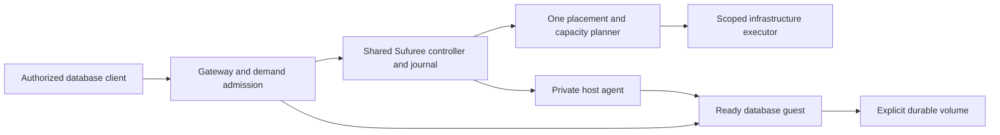

# RFC-0002: Sufuree — scale-to-zero databases

**Status:** Accepted design on merge of PR #1 through the owner-authorized independent review and merge workflow; bounded version-one database scope. This is the canonical database extension to [RFC-0001](0001-scale-to-zero-unikernel-runtime.md). Acceptance approves the scope and proposed mechanisms, not implementation, durability proof or achieved cost savings.

**Updated:** November 1, 2026. **Control language:** Go. **Initial database candidate:** SurrealDB. **Packaging:** One Sufuree repository with application and database command groups and shared in-repository packages. Command names remain proposed (`sufuree app`, `sufuree db`); commands do not determine the number of runtime services.

Sufuree starts isolated database instances on demand and safely stops their compute when idle. The aim includes supporting many independently managed instances for future applications, rather than paying for a running database for every inactive instance. Existing application migration is outside this design discussion and remains the owner's responsibility.

## 1. Requirements and scope

- Treat a database instance as an opaque managed identity with persistent storage, resource limits, credentials, readiness and wake/sleep policies. Sufuree does not define customers, apps or the calling product's configuration model; callers map their concepts to instance identities.
- Use one repository, shared packages and one authoritative host-capacity planner. Database lifecycle rules extend the common runtime; they do not create a competing scheduler.
- Default backend pools to `minHosts=0`. Prefer suitable existing capacity, start a host only when needed, retain it for a configurable quiet period after activity, then remove it after safe drain. Optional warm capacity trades extra cost for lower startup latency.
- Target several seconds for ordinary activation on a ready host with capacity and required data available. Starting a host is an explicit slower exception, potentially minutes, subject to measurement and deadlines.
- SurrealDB is a deliberate candidate for its deployment packaging and multiple data models. Unikernel compatibility, performance and durability remain qualification questions; a single executable is not proof.
- Preserve acknowledged committed writes through ordinary sleep and guest/host failure when the durable volume survives. Volume loss and backup recovery have separately defined recovery objectives.
- Never allow two active writers to the same database dataset. Keep storage identity and recovery authority explicit across failure and restart.
- Sleeping instances still incur retained storage, backup and control-plane costs. Do not claim the entire bill reaches zero or that 100,000 inactive instances have been qualified.

The first qualification slice is one pinned SurrealDB release and persistent storage engine in an isolated Linux microVM, followed by a unikernel comparison under the same acceptance criteria. This is a proposed qualification sequence, not a decision to abandon unikernels. Prove wake, clean drain, surviving-volume crash recovery, host scale-to-zero and restoration on a replacement host.

Defer distributed database clustering, cross-region active-active replication, router-held live-query subscriptions across sleeping engines, schema-to-MCP generation and embedded function platforms. Do not make migration tooling a prerequisite for defining Sufuree.

## 2. Repository, commands and shared packages

Use one Sufuree repository. Application and database command groups submit desired state to the same platform. Do not create a separate `sufuree/pkg` repository now. Package names below are proposed boundaries, not existing code:

| Shared package | Responsibility |
| --- | --- |
| `internal/lifecycle` | Desired/observed state, generation-bound activity leases, bounded activation, drain and reconciliation. |
| `internal/journal` | Durable intent before effects, stable operation identities, outcome reconciliation and persistent generations. |
| `internal/scheduler` | CPU/RAM/runtime/storage admission, placement reservations and the single host-capacity policy. |
| `internal/gateway` | Route resolution, bounded forwarding, readiness and application-replica routing; database traffic follows its authoritative writer. |
| `internal/executor` | Guest/runtime capability interfaces, host-agent operations and lifecycle observations. |
| `internal/telemetry` | Common lifecycle, request, capacity and cost measurements. |

Database-specific code adds engine readiness, storage identity/fencing, safe engine shutdown, backup and restore contracts. Generic lifecycle code must not embed SurrealDB query semantics. Shared code does not mean shared credentials or unrestricted mutation authority.

the source orchestrator is a reuse source, not an importable collection of `internal/` packages. First resolve RFC-0001 F03's durable-transition gap and agree a supported extraction/API boundary with the source orchestrator. If both repositories later consume a common library, choose its public module/versioning separately; this RFC does not require a new package repository or silently copy a second independently maintained scheduler.

## 3. Ownership and runtime components

| Role | Responsibility and boundary |
| --- | --- |
| CLI command groups | Configure application/database instances and observe status through authenticated control APIs. They are not independent control planes. |
| Gateway | Admit authorized traffic, trigger/join activation and forward to ready endpoints. Application replicas use RFC-0001 load balancing; a single-writer database has one writable endpoint. |
| Controller | Persist desired state and operations, assign placement, reconcile outcomes and manage one capacity ledger. Database lifecycle handlers enforce stateful requirements. |
| Host agent | Execute generation-bound assignments, manage private guest networking and storage, report readiness and perform safe shutdown. |
| Application/database guests | Run workload code or the pinned database engine within qualified isolation/resource boundaries. |
| infrastructure custody / owning IaC | Custody of provider host, network, volume and snapshot effects through a scoped, budgeted contract. No unrestricted provider credentials on the public gateway. |
| Product callers | Own customer/application mapping, identity and domain behavior; consume supported Sufuree interfaces without transferring credential or data custody. |
| external observability | Observe operational evidence and recovery outcomes; observation does not grant mutation authority. |

Logical roles may share processes or machines where qualified. Start with a small reachable gateway/controller and private host agents/guests. Database guests may share suitable hosts with application guests while retaining independent VM/storage boundaries, reservations and protection from preemption. Separate host pools are optional isolation/resource policy, not a mandatory second paid baseline. All pools remain under one capacity authority.

Co-location creates shared failure domains. A gateway/controller failure may interrupt connections and delay new work. The durable journal and authenticated host protocol must recover ownership; a host may finish an already-committed drain and report it later, but must not invent new placement or release shared storage ownership while disconnected. Keep the journal and activation path available when backend hosts are zero. Do not store their only copy in a database they must themselves wake.

## 4. Architecture and single-writer fencing

Every database instance has a stable identity, immutable engine/image revision, explicit volume identity, permitted writer and persistent placement epoch. Record intent before dispatching effects, retain unresolved operations and reservations on timeout, and reconcile before retry.

Database instances use RFC-0001's [declarative reconciliation contract](0001-scale-to-zero-unikernel-runtime.md#declarative-control-and-reconciliation). The spec declares engine/image revision, storage identity, resources, access policy, wake/sleep and retention rules; status reports the observed writer, readiness and recovery conditions. An enabled but idle database can be dormant while retaining its data. Demand changes its execution target without rewriting the spec. Suspension drains and disables activation; deletion is separately authorized and remains blocked until storage/retention cleanup is reconciled. Changing engine revision initiates the qualified upgrade procedure, never an implicit second writer. Reconciliation cannot infer whether an application transaction committed from transport failure alone.

A monotonically increasing epoch fences cooperating control/host agents; it is not by itself a storage write fence. Version one uses RFC-0001's [executor and ownership contract](0001-scale-to-zero-unikernel-runtime.md#scoped-executor-and-enforceable-ownership): for an unreachable AWS writer, terminate its exact instance and observe confirmed termination before reconciling attachments and activating a replacement. Loss of heartbeat alone is insufficient. If termination cannot be confirmed, refuse conflicting activation and surface the availability failure. This favors data safety over automatic availability during an unresolved provider/host failure.

Normal relocation requires clean engine shutdown, volume unmount, confirmed guest exit and provider attachment reconciliation. Attachment/detachment commands name both the registered volume and exact host identity; a stale command cannot operate on whichever host happens to own the volume later. Do not use EBS Multi-Attach. A forced detach is an explicit owner recovery action after writer fencing, not a normal scaling shortcut or proof of a clean filesystem. AWS warns that [forced EBS detachment can damage filesystem/data consistency](https://docs.aws.amazon.com/ebs/latest/userguide/ebs-detaching-volume.html). Run integrity/recovery checks before serving another generation. The selected provider fence must still pass failure tests.

## 5. Engine and guest runtime qualification

SurrealDB is a strong candidate because it ships as a single binary and provides relational, document, graph and vector primitives over HTTP and WebSockets using Namespace/Database multi-tenancy. However, **unverified assumptions about unikernels and storage engines are major risks.**

### 5.1 Guest OS: Linux microVM vs. Unikernel qualification

The intended database guest is a qualified unikernel; a Linux guest is the reference and compatibility fallback. Go/Rust packaging alone does not establish memory-mapping, thread, locking or flush correctness.

1. First establish a minimal Linux/QEMU/KVM reference with an explicitly registered data filesystem and the pinned engine. This is the baseline for comparing storage and recovery behavior, not a decision to replace the intended unikernel tier.
2. Qualify the intended Nanos/QEMU/KVM guest under the same crash/recovery/durability criteria, using its own explicitly manifested filesystem format. Do not call the production guest qualified until that path passes. Linux fallback is reported explicitly if a concrete incompatibility is found; data-format changes require controlled export/restore.
3. Firecracker/Unikraft and other combinations are separate later profiles, not implicit options for the initial raw-volume path.

### 5.2 Storage backend qualification

Pin the SurrealDB version and verify its supported persistent-engine configuration before testing. Start qualification with SurrealKV; consider RocksDB only if available in the pinned release and justified by the comparison. Neither engine is pre-qualified. Do not infer durability, footprint or supported features from its implementation language.

Compare binary and resident-memory footprint, acknowledged-write durability settings, locking and filesystem behavior, recovery time, background I/O/compaction, idle shutdown and version-upgrade compatibility. Use repeated start/write/stop cycles (a proposed 1,000-cycle soak) plus crash, disk-full and interrupted-shutdown injection. Repetition alone is not a durability proof. Select the default only after the same workload and failure tests pass on the qualified guest/VMM/storage combination.

### 5.3 Instance identity and isolation

The independently scheduled unit is a database instance with its own guest and registered persistent storage. SurrealDB namespaces/databases may be used within that instance by its authorized owner, but they are not independent VM or sleep boundaries. Sufuree does not prescribe one instance per customer, app or combination; the caller chooses the mapping. Activity anywhere in a shared engine can keep that engine awake.

## 6. Connection protocol and transaction lifecycle

Qualify the selected SurrealDB release and client protocol explicitly. HTTP request boundaries can support bounded activity accounting; WebSocket/TCP connections can retain session or transaction state and initially pin the guest. Request completion alone is not proof that all engine background obligations have ended.

### 6.1 Request activation and lease accounting

Using the shared in-repository lifecycle and gateway packages:

1. **Admission & Auth:** Validate caller identity/network policy and per-database connection/queue limits at the DB demand gateway before creating wake demand. Do not inspect or log sensitive query payloads or credentials.
2. **Stateless HTTP (`/sql`):** Acquires an activity lease for the duration of the HTTP request/response stream. Ideal for scale-to-zero because the lease releases immediately after the response flushes.
3. **WebSocket (`/rpc`) & TCP Streams:** Acquires an activity lease for the lifetime of the open connection (`RFC-0001` Section 4 rule: active streams pin the guest).
* **Client Contract for Scale-to-Zero:** Applications using WebSocket RPC must configure an idle connection timeout in their SDK/client or prefer HTTP `/sql` for intermittent transactions; otherwise, an eternally open client WebSocket will legitimately prevent the database guest from scaling to zero.
* **Deferred feature:** Intercepting and holding `LIVE SELECT` WebSockets at the gateway while sleeping the SurrealDB guest is explicitly deferred (`RFC-0001` F15).

Specify how admission works while the database is asleep: a scoped gateway credential or authenticated private workload identity must be verifiable without querying that database. Network reachability alone is not full database authorization. Native engine credentials and per-operation authorization still apply after readiness. Keep application credentials intact, redact them from logs and prevent callers from selecting arbitrary instance addresses. The exact credential, rotation and revocation mechanism remains part of RFC-0001 F07.

Connection/request leases are necessary but not sufficient evidence that a database can stop. The pinned engine adapter must account for transaction/session lifetime, imports, background jobs and durability work that can outlive an HTTP response. Either declare these operations unsupported for the initial sleep contract or hold explicit lifecycle protection until qualified completion. Database health probes use the non-demand management path and do not refresh idle timers.

### 6.2 Lost replies, uncertain commits and optional safe retries

Default contract: a transport failure after forwarding may leave a write outcome unknown. Sufuree must not turn that into a claim of rollback, success or permission to replay. Distinguish rejection before forwarding, verified engine commit/abort results, and unknown outcomes. An opaque native protocol may only expose its normal connection/error behavior; document the uncertainty and record correlation metadata without inventing a database protocol response or logging query contents. Read-only retry also requires a declared safe operation, not guessing from an HTTP method or arbitrary SQL text.

For applications requiring safe retry, propose an opt-in operation contract in an application/qualified engine adapter. Do not transparently rewrite arbitrary SQL or multi-request transactions at the gateway:

1. The caller supplies a stable operation ID scoped to its authorized database and operation identity, plus a fingerprint of the immutable request. Reuse the same ID for a retry; a changed request with that ID is rejected.
2. The adapter atomically commits the business mutation and a deduplication/result record in the **same database transaction**. Use an enforced unique operation key or equivalent conflict mechanism; a prior existence query alone is unsafe under concurrency. Keep result access scoped and authorized.
3. If the reply disappears, the caller can query that operation or resubmit it through the same protected contract. A matching committed record returns the stored outcome without repeating the mutation. An absent record is not proof that the first attempt has finished or aborted: concurrent attempts must still contend on the same transactional key, and conflict handling must re-read/reconcile under a fresh transaction.
4. Define bounded operation retention and expiry behavior. An old ID must not silently become a new write after its record is removed; retain a suitable tombstone or enforce a qualified operation-validity window. Backup rollback or loss of operation records may remove this guarantee and must be exposed as recovery uncertainty, not hidden by replay.
5. The guarantee covers the qualified database mutation only. Calls to payment, email or other external systems need their own idempotency/reconciliation contract; placing their invocation inside database transaction code does not make the external effect atomic. Do not promise generic exactly-once execution.

SurrealDB documents [atomic transaction groups](https://surrealdb.com/docs/reference/query-language/statements/begin) and [unique-key conflict behavior](https://surrealdb.com/docs/learn/querying/concepts-and-guides/transactions). These are candidate primitives, not proof that this adapter exists or behaves identically across releases. Pin and qualify the actual engine/client version. The operation record belongs beside the affected application data, not in Sufuree's infrastructure journal: two independent commits would recreate the same uncertainty window.

The generic Sufuree runtime owns bounded forwarding, correlation and honest outcome classification. Keep this supported-operation contract separate from raw forwarding; ordinary native clients remain supported with documented uncertain-write behavior.

#### SurrealDB-specific adapter and guarantee boundary

Selecting an engine up front lets Sufuree provide and qualify a first-class SurrealDB adapter instead of asking every application to implement retry/deduplication correctly. Propose that the adapter own the atomic operation/result record, conflict classification, bounded retry/backoff, result lookup, authorization scope and expiry rules for its explicitly supported transactional operations. An SDK can create an operation ID before its first send and retain it across transport retries. A separately initiated caller request still needs the same operation ID if it represents the same intended mutation; the platform cannot infer that from an identical query alone.

The current [SurrealDB transaction contract](https://surrealdb.com/docs/learn/querying/concepts-and-guides/transactions) distinguishes atomic groups, conflicts on shared keys/unique-index entries and unknown commit outcomes. Snapshot isolation does not prevent every business invariant violation. Its [idempotency guide](https://surrealdb.com/docs/learn/querying/concepts-and-guides/idempotent-operations) also distinguishes fixed-value writes from operations such as increments that change state on repetition. Pin the actual release/storage backend; these documentation claims are inputs to qualification, not receipts for the proposed guest.

| Engine contract | Adapter proposal | Limit to preserve |
| --- | --- | --- |
| Atomic transaction plus unique operation key | Commit supported mutation and saved result together; retrying the same operation returns its prior outcome. | Requires retained durable operation records and the same request identity; not transparent protection for arbitrary native queries. |
| Explicit conflict proving transaction abort | Retry the whole supported transaction under a fresh snapshot, within its deadline. | Classify pinned engine error results; never treat a lost connection as a confirmed abort. Exclude unprotected external effects. |
| Snapshot isolation and key-level conflicts | Protect the deduplication key and validate the transaction patterns Sufuree offers. | Generic business invariants may need stronger isolation or explicit coordination; safe retry does not make arbitrary logic serializable. |
| Commit outcome remains unknown after communication loss | Resolve by the atomic operation record when reachable; otherwise retain unknown status. | Do not promise an immediate answer during a partition, after loss of the data/record, or after unqualified backup rollback. |

The qualification target is **at most one committed mutation per operation ID within the supported durability/retention contract, with recoverable results once the database is reachable**. It is not a blanket exactly-once execution claim. Test lost replies before/after commit, simultaneous retries, guest/host crash, error decoding, ID mismatch, retention expiry and recovery from backup for the pinned adapter. Do not ship a SQL-rewriting proxy and label it equivalent to this contract.

### 6.3 Safe transactional drain and shutdown sequence

A database guest must never be stopped by an ungraceful VMM kill during normal scale-in. The local reconciler executes a strict multi-step drain:

1. **Close Gateway Admission (`AcquireRequest` $\to$ `STOPPING`):** New incoming requests block in the gateway's bounded activation queue for the *next* generation rather than entering the draining guest.
2. **Drain In-Flight Operations:** Wait for all active HTTP requests and open WebSocket/TCP streams to reach zero within a bounded drain timeout.
3. **Graceful Engine Shutdown (`SIGTERM`):** Send `SIGTERM` to the SurrealDB process inside the guest. Use the pinned engine adapter to verify its documented shutdown behavior and clean exit. Signal delivery or exit code alone is not proof that acknowledged writes are durable; qualify the complete engine/filesystem/volume path.
4. **Filesystem Sync & Unmount:** Inside the guest (or via clean guest ACPI shutdown), execute `sync` and cleanly unmount the persistent data volume using the manifested filesystem and qualified guest shutdown mechanism; do not assume a unikernel exposes Linux mount or signal tools.
5. **Confirm VMM Exit:** Only after VMM exit and clean unmount may the host reconciler report the guest `DORMANT` and release the volume for detachment or host scale-in.

If a planned drain times out at step 2 and engine shutdown has not begun, it may be cancelled by an authorized reconciliation: atomically reopen admission for the same healthy generation with its leases/reservations intact. Once shutdown or a failure fence begins, admission stays closed until recovery. Otherwise retain active leases and reservations and report the blocked drain; do not force-close a transaction to meet the idle timer. If steps 3–5 time out or fail, mark the database generation `UNCERTAIN / FAULTED`, retain the host and volume reservation, alert observability, and refuse automatic forced volume detachment until reconciled. New demand cannot revive or replace a partially stopped generation without reconciliation.

---

## 7. Storage custody, durability and recovery

Apply the persistent identity and verified-recovery requirements in RFC-0001 Section 7:

1. **No Anonymous Volumes:** The database coordinator rejects any workload specification that lacks an explicit, registered `volume_id`, filesystem UUID/header verification, and retention policy. Stopping a guest or terminating a host must never trigger automatic deletion of a database volume.
2. **Write Durability Contract ($RPO = 0$ for committed writes on surviving volume):** A successfully committed transaction acknowledged under the pinned engine/client durability contract must survive on the persistent volume, not solely in guest RAM. HTTP `200 OK` alone is not a commit receipt: validate statement/transaction results and error bodies, including [protocol-level errors](https://surrealdb.com/docs/reference/rest-api/errors). Memory snapshots are not used as the database durability mechanism (`RFC-0001` F10). Admission requires an explicit engine sync/durability mode in the versioned manifest that guarantees acknowledged commits reach the durable path; asynchronous or unverified default modes are rejected. Determine the exact flag/API for the pinned engine release and test it rather than assuming its defaults satisfy this contract.
3. **Automated Backup & Non-Empty Verification:**
* Before planned relocation or maintenance, and on a defined schedule following write activity, obtain a verified recovery point using a qualified logical export and/or block-level snapshot procedure. Label whether a snapshot is application-consistent or crash-consistent, and record the engine/image/configuration version needed to recover it. After unexpected host failure, recovery uses the surviving volume or the last verified backup; do not pretend a new export from an unreachable host is available.
* **Anti-Empty-Backup Gate:** Every backup job must record row/table counts or cryptographic digest metadata and periodically test restoration into an isolated scratch guest. A backup that restores an empty database when prior state was non-empty is treated as a critical failure.

### Storage implementation, recovery objectives and deletion

Version-one qualification uses one encrypted, explicitly registered EBS data volume per database instance, with deletion-on-host-termination disabled. The host attaches the volume in its availability zone, verifies volume/filesystem identity and passes it as a raw block device to one QEMU/KVM guest. The host never mounts the guest's writable data filesystem. QEMU is the first VMM candidate for this path; Firecracker and host-directory-backed storage are not interchangeable fallbacks.

Use a cache configuration that preserves guest flushes (`cache=none` as the initial QEMU candidate, never `cache=unsafe`) and qualify alignment/I/O backend support on the chosen host. The engine and guest filesystem must propagate committed-write barriers through the virtual block device to EBS. Provider attachment alone is insufficient. Pin the data format: the Linux reference guest uses a qualified filesystem such as ext4; the intended unikernel guest requires its own supported format and durability qualification. Do not boot an incompatible guest over an existing volume or silently reformat it. A runtime change that changes the data format is an explicit export/restore operation.

SurrealKV is the initial persistent-engine candidate; compare another engine only if supported by the pinned SurrealDB release and justified by failed qualification or measured limitations. Keep the engine/image/format/version in the volume manifest. The Linux reference remains a comparison and fallback qualification path, not evidence that the unikernel path works. A database cannot be admitted as production-qualified until the selected entire path passes the durability and recovery scenarios below.

Surviving-volume recovery and volume/AZ loss are different guarantees. Record a maximum acceptable backup age/data-loss window and restore-time objective for each supported policy. Do not imply zero committed-write loss after losing the only durable volume. Define key and backup custody outside that failure domain, authorize any cross-zone copy/recovery, validate restored instance identity and data before changing routes, and retain the previous recovery assets until acceptance. Point-in-time recovery is not promised until the pinned engine's log retention and replay path is qualified.

Initial personal/development policy: target zero loss of acknowledged committed writes when the durable volume survives; target a recovery point no older than one hour for loss of that volume, using hourly snapshots for volumes with a writer since their previous recovery point. Retain 24 hourly and seven daily recovery points. Capture a pre-upgrade recovery point separately. These are configurable policy defaults and qualification targets, not guarantees already achieved. A failed/late backup reports degraded protection and the actual oldest-loss window; it does not continue advertising the one-hour target as satisfied.

Snapshots taken while the engine is active are explicitly crash-consistent unless the engine adapter proves application consistency. The pinned engine's recovery and flush behavior must make that path safe before it is enabled. A dormant volume can be snapshotted without starting its database or a backend host. For long-dormant data with no new writer, retain its last validated state instead of creating identical hourly copies. Keep backup scheduling authority and scoped worker invocation available in the always-on control tier; provider credentials remain in the worker and backup transfers use restricted presigned object URLs. Include snapshot/API/retention costs and cap work during wake storms.

Propose a 15-minute recovery-time target for the bounded initial dataset fixture; publish measured dataset size and actual restore duration before offering that objective to callers. Restore the first recovery point and periodic policy-selected samples into an isolated guest, checking schema, records and integrity against the recorded point. Backups stay regionally recoverable with the required keys/permissions outside the failed instance/AZ. Cross-region/account-loss protection and point-in-time recovery are separate opt-in capabilities, not implied here.

Engine upgrades require an explicit compatibility matrix, a verified pre-upgrade recovery point, one writable generation, readiness/data validation and a rollback decision. Rolling back an executable must not assume it can read a newer on-disk format. Restoring a backup to undo an upgrade can discard later commits and must not happen as an invisible automatic rollback.

Stop and delete are separate operations. A deliberate delete requires instance-specific authority, writer drain/fencing, durable intent, retention/backup disposition and reconciliation of the actual provider outcome. Keep a tombstone so stale wake requests cannot recreate a deleted identity or attach its retired volume. Failure, budget exhaustion or inactivity is never deletion authority.

The default delete disposition is retain data/backups pending an explicit retention/grace policy; deletion of the compute resource alone never deletes its volume. Data destruction requires a distinct authorized operation naming the exact volume/snapshot identities. Retain identity tombstones independently of data retention so late requests cannot resurrect retired instances.

---

## 8. Host scheduling and scale-to-zero

The shared Sufuree planner accounts for database and application capacity together. Database placement adds stateful constraints; it does not create an independent host owner:

* **Placement Affinity by Volume Location:** A database guest must be scheduled into the same Availability Zone as its backing EBS block volume (unless restoring from a cross-AZ snapshot under an explicit recovery procedure).
* **Attachment Limits:** Account for cloud provider block-volume attachment limits per instance type (e.g., AWS Nitro EBS attachment limits) as a hard scheduling dimension alongside CPU and RAM.
* **No Scheduling Preemption:** New workload demand cannot preempt a database guest (RFC-0001 Section 5). Explicit failure fencing follows the full affected-host protocol in Section 3 and can crash all co-hosted guests; choose dedicated placement when that recovery blast radius is unacceptable.
* **Cold Start Reality (`minHosts=0`):** When the database host pool is at zero, the first database query incurs:

$$\text{Host Provisioning} + \text{EBS Volume Attach} + \text{Guest Boot} + \text{SurrealDB Engine Readiness}$$

Follow the canonical [activation latency contract](0001-scale-to-zero-unikernel-runtime.md#cold-start-from-zero): target several seconds on a ready host with capacity and storage available; host startup is an explicit slower exception, potentially minutes. No EC2/EBS startup range has been measured for this design. Database readiness includes storage mount and engine recovery, not just guest boot. Measure host provisioning, attachment, boot, engine readiness and first successful query separately. Caller deadlines remain bounded even if the admitted provisioning operation has a longer deadline; never replay a query that may already have executed. Restore from backup is a separate recovery path, not ordinary wake-up.
* **Owner-directed default:** Use suitable running capacity first; start hosts only when admitted demand cannot fit. Default pools to zero minimum hosts. After activity, retain hosts for a configurable quiet period to avoid repeated cold starts, then terminate only after every guest has safely drained and storage is reconciled.
* **Optional warm capacity:** A deployment may pay to retain spare ready capacity for faster activation. Make its cost visible. A warm host without free resources, required artifacts or access to the data cannot satisfy the ordinary activation target.
* **Windows and reservations:** Guest idle windows and host quiet periods are separate controls. Storage cleanup, active streams, recovery and uncertain operations keep reservations until resolved. Tune windows from observed startup cost and traffic; do not impose an unmeasured universal timer.
* **Large idle fleets:** Before claiming large-scale support, measure controller metadata/index size, dormant volume and snapshot cost, provider volume/attachment quotas, backup scheduling and wake storms. Detach dormant volumes where safe so attachment slots are not reserved indefinitely. One durable volume per instance is the initial proposal, not proof of economical operation at 100,000 instances.

---

## 9. Observability and sizing

In addition to the shared in-repository telemetry (`RFC-0001` Section 9), the database service must expose:

| Category | Required measurements | What they resolve |
| --- | --- | --- |
| **Storage & Volume Health** | Volume used/free bytes, inode usage, read/write IOPS, disk throughput, cloud volume burst-balance/IOPS credits, attach/detach duration | Whether disk size, IOPS provisioning or EBS burst credits are exhausting |
| **Database Engine** | Active HTTP vs WebSocket connections, query latency (p50/p95/p99), resident memory (RSS) vs guest limit, WAL size, compaction duration | Whether SurrealDB fits the guest memory allocation and whether open sockets prevent idle stop |
| **Drain & Durability** | `SIGTERM`-to-exit duration, unmount duration, dirty shutdown count, backup age, last verified restore timestamp and record count | Whether shutdown windows are safe and whether backups are current and non-empty |
| **Cost Attribution** | Compute host hours, retained EBS GB-month, provisioned IOPS, snapshot storage GB-month | True gross cost of the scale-to-zero database tier vs managed RDS/DynamoDB |

---

## 10. Review findings and qualification gates

| ID | Gate | Version-one design disposition | Evidence still required |
| --- | --- | --- | --- |
| **DB-01** | Shared lifecycle | One shared runtime and executor; satisfy RFC-0001 F03 before reuse. | Durable-before-effects and error propagation tests. |
| **DB-02** | Write fencing | Exact-host termination for unreachable AWS writers, observed completion, attachment reconciliation; no Multi-Attach or routine force-detach. | Partition/stale-writer/provider-timeout tests with no conflicting writer. |
| **DB-03** | Engine/runtime | SurrealKV first qualification candidate, Linux reference and intended unikernel comparison under the same pinned-data contract. | Crash, repeated wake/stop, fsync/locking, memory and compaction tests. |
| **DB-04** | Persistent sessions | Open streams and declared engine work pin the guest; clients close idle sessions to permit sleep. | Connection/transaction lifetime and visible blocked-drain tests. |
| **DB-05** | Startup | Separate ready-host activation from host/volume provisioning; bounded request/dependency deadlines. | Measured first-query latency and timeout recovery without replay. |
| **DB-06** | Backups | Hourly changed-volume recovery points, 24 hourly/seven daily retention, verified restore and explicit crash-consistency labeling. | Recorded real-data restore/integrity checks; stale protection surfaced accurately. |
| **DB-07** | Storage path | Retained encrypted EBS raw block device, one QEMU guest filesystem owner, preserved flushes and manifest-bound format. | Full guest-to-device flush and failure tests; no host/guest simultaneous mount. |
| **DB-08** | Recovery/upgrades/delete | RPO zero for surviving-volume committed writes, one-hour volume-loss target; bounded restore target, single-writer upgrade, explicit retained deletion/tombstones. | Measured objectives, format-compatible rollback and stale-request-after-delete tests. |
| **DB-09** | Large fleets | Capacity/volume/attachment quotas, bounded metadata/telemetry and explicit idle storage costs. | No large-fleet or savings claim until scale/quota/cost measurements pass. |

## 11. Qualification and acceptance

None of these behaviors is claimed today; each must be demonstrated with recorded receipts before claiming database runtime or durability qualification:

| Scenario | Required observation |
| --- | --- |
| **Cold wake from zero hosts** | Request arrives with `0` DB hosts $\to$ single host provisioned $\to$ explicit volume attached with incremented fencing epoch $\to$ guest boots and SurrealDB passes readiness $\to$ query succeeds within a caller-opted-in cold-start deadline, or the default short wait returns a not-yet-forwarded retryable result followed by success on a safe later attempt. |
| **Concurrent wake demand** | 20 concurrent queries arrive while DB is dormant $\to$ exactly one volume attach and guest start occurs $\to$ all 20 queries complete without lock errors. |
| **Transaction durability across idle stop** | Client commits write (`INSERT`/`RELATE`), receives a verified successful transaction-commit result $\to$ guest drains cleanly (the qualified engine flush and guest shutdown sequence) and host scales to zero $\to$ subsequent wake returns exact committed rows. |
| **Simulated host crash mid-write** | Kill host/VMM abruptly during load $\to$ coordinator fences old host and detaches volume $\to$ new guest mounts volume, replays WAL without corruption, and preserves all previously acknowledged writes. |
| **Stale host partition (Split-brain test)** | Partition Host A while DB guest is running $\to$ verify controller refuses to mount the volume on Host B until the old writer is demonstrably fenced and the volume has passed the required recovery checks; timeout or a force-detach response alone cannot authorize activation. |
| **Cancelled planned drain** | Before engine shutdown starts, admission can reopen for the same healthy generation with all leases intact; after shutdown starts, demand waits for recovery instead. |
| **Pinned WebSocket visibility** | Client holds an idle WebSocket open $\to$ DB remains running safely (no forced mid-session kill) and observability clearly reports the open socket blocking idle stop. |
| **Anonymous or missing volume rejection** | Attempt to register or boot a DB workload without a pre-existing verified `volume_id` $\to$ admission fails without silently substituting an empty or ephemeral volume. |
| **Failure-boundary isolation test** | Overload or restart the `RFC-0001` application ingress/controller while the DB service is draining $\to$ new admission fails safely; a host may complete an already-committed local drain, while shared ownership and detachment remain reserved until the controller reconciles. No claim of independent failure immunity is made for co-located roles. |
| **Engine work outlives HTTP response** | A qualified transaction/import/background operation remains protected after the response, or is explicitly rejected as unsupported; idle detection cannot stop it prematurely. |
| **Volume loss and upgrade recovery** | Recover an isolated copy using retained keys and the declared recovery point; verify data and engine compatibility, report any data-loss interval, and never silently replace the live writer. |
| **Deletion followed by stale wake** | Authorized deletion records a tombstone and reconciles retention; replayed old requests cannot resurrect the identity or attach retired data. |
| **Dormant fleet and wake storm** | Metadata, queues and telemetry remain within declared resource budgets; quota/attachment limits yield bounded admission without duplicate hosts or volumes. |
| **Reply lost after commit** | Generic forwarding reports uncertainty without replay. An opted-in adapter retry with the same ID returns the saved result and leaves exactly one committed mutation, including across engine restart. |
| **Concurrent operation retries and expiry** | Simultaneous identical IDs cannot commit duplicate mutations; changed payload is rejected; an absent/in-progress or expired record never falsely proves rollback or authorizes an unprotected new attempt. |

---

## 12. Acceptance and provenance

Owner direction includes one repository/shared runtime, a SurrealDB-focused database capability, independently managed database identities, zero idle backend compute and optional warm capacity. The concrete first-version storage, fencing, networking, recovery and optional operation-ID adapter contracts are now specified for acceptance. Engine/runtime/library versions and measured thresholds are pinned during qualification, not treated as already working.

**Final RFC disposition: accepted upon successful independent review and merge of [PR #1](https://github.com/sufuree/sufuree/pull/1), including RFC-0001.** The owner authorized this headless Claude Code review-and-merge workflow on November 1, 2026. Acceptance concerns design scope only; it does not claim runtime qualification or authorize provisioning, spending, migration or deployment. Native forwarding retains unknown-write outcomes; stronger operation-ID semantics apply only to qualified supported operations.

This document promotes and revises the owner's working database proposal. It replaces that working draft; RFC-0001 remains canonical for common runtime, networking, load balancing, ownership and host scaling. The database extension does not duplicate those policies. No implementation or private operational receipt is implied by this public design.
